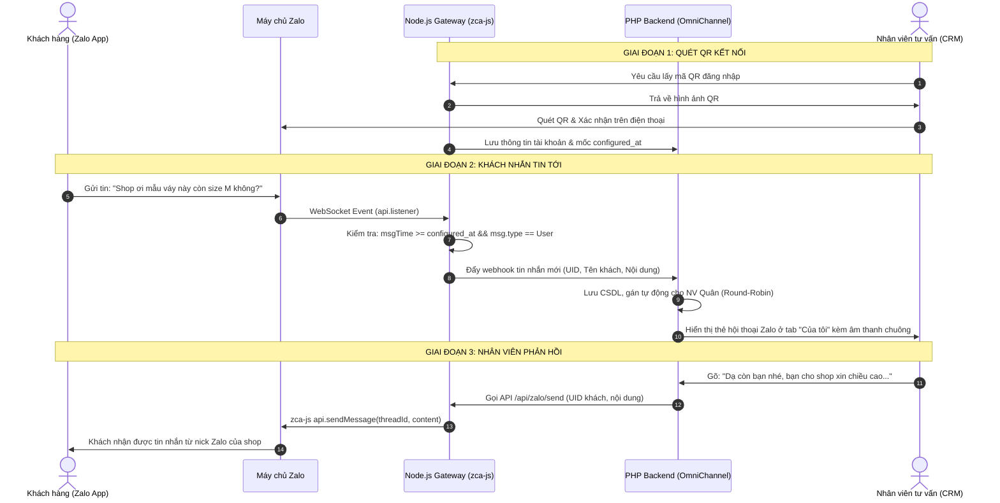

# KẾ HOẠCH TRIỂN KHAI TÍCH HỢP ZALO CÁ NHÂN (`zca-js`) VÀO OMNICHANNEL CRM

> **Tài liệu đặc tả kỹ thuật, kiến trúc module hóa và lộ trình triển khai chi tiết**  
> *Phiên bản:* 1.0 — *Ngày lập:* 24/10/2026 — *Trạng thái:* Đã phê duyệt nguyên tắc kiến trúc (Chưa viết code triển khai)

---

## 1. TỔNG QUAN & BỐI CẢNH DỰ ÁN

### 1.1. Mục tiêu kinh doanh & Bài toán thực tế
- **Thực trạng**: Tại Việt Nam, một lượng rất lớn khách hàng có thói quen nhắn tin hỏi mua sắm, tư vấn qua **Zalo cá nhân** thay vì Zalo Official Account (Zalo OA) do tâm lý ngại form đăng ký hoặc thích trò chuyện thân mật trực tiếp với chủ shop/tư vấn viên.
- **Mục tiêu**:
  1. Cho phép chủ cửa hàng kết nối một hoặc nhiều tài khoản Zalo cá nhân vào hệ thống OmniChannel CRM chỉ bằng thao tác **Quét mã QR** trên điện thoại.
  2. Toàn bộ tin nhắn khách hàng gửi tới Zalo cá nhân sẽ được hệ thống tiếp nhận tập trung, tự động chia tải (Round-Robin) cho các nhân viên trực ca trên giao diện Web Workspace.
  3. Mọi nhân viên phụ trách khi gõ tin nhắn phản hồi trên CRM thì khách hàng trên Zalo vẫn nhận được tin nhắn từ chính tài khoản Zalo cá nhân đó (nhân viên dùng chung kênh Zalo để tư vấn mà không cần cầm điện thoại).
  4. Đảm bảo trải nghiệm demo thực tế nhẹ nhàng, tin cậy, không làm tràn dữ liệu tin nhắn cá nhân riêng tư của người thân/bạn bè.

---

## 2. NGUYÊN TẮC KIẾN TRÚC: CHỐNG SPAGHETTI & TÁCH BIỆT MODULE

### 2.1. Vấn đề kiến trúc hiện tại
Các file lõi hiện tại như `public/widget/webchat.js` (~1900 dòng), `public/js/workspace.js` (~5000 dòng) và `omnichannel-webhook-gateway/server.js` đã đạt trạng thái hoạt động rất ổn định phục vụ các Use Case cốt lõi (Webchat, Google Sheets, CRM Profile, Quản lý nhãn, Mẫu tin nhắn).
Nếu tiếp tục nhồi nhét logic Zalo, QR code, polling vào các file này sẽ dẫn đến:
- Mã nguồn bị phình to (spaghetti code), khó đọc, khó debug.
- Rủi ro cao làm gãy vỡ (regression bug) các tính năng chat và Google Sheet đã hoàn thiện.
- Khi cần nâng cấp hoặc đổi thư viện Zalo sẽ phải sửa đổi toàn bộ file lớn.

### 2.2. Giải pháp: Kiến trúc "Isolated Module" (Tách biệt hoàn toàn)
Toàn bộ tính năng Zalo cá nhân sẽ được đặt trong các file và thư mục **hoàn toàn riêng biệt**, giao tiếp với hệ thống lõi thông qua API contracts và Custom Events:

```
[Hệ thống OmniChannel]
   │
   ├── 📂 omnichannel-webhook-gateway/ (Node.js Gateway trên Render)
   │     └── 📂 modules/zalo/             <-- THƯ MỤC RIÊNG BIỆT CHO ZALO
   │           ├── zaloManager.js        # Quản lý vòng đời client Zalo (Multi-account Map)
   │           ├── zaloListener.js       # WebSocket listener, lọc tin nhắn thời gian thực
   │           ├── zaloRoutes.js         # Express Router riêng (/api/zalo/*)
   │           └── zaloStorage.js        # Quản lý lưu trữ phiên/cookies mã hóa
   │
   ├── 📂 PHP Backend (InfinityFree / XAMPP)
   │     ├── controllers/ZaloController.php # Controller riêng xử lý webhook & gửi tin
   │     ├── models/ZaloAccount.php         # Model quản lý bảng CSDL zalo_accounts
   │     └── api/zalo_action.php            # Endpoint API riêng (không sửa sync_polling/message_action)
   │
   ├── 📂 Frontend (CRM Web Workspace)
   │     ├── public/js/zalo_channel.js      # Module JS riêng: Xử lý Popup QR, trạng thái kết nối
   │     └── views/chat/modals/modal_zalo_config.php # File view modal riêng biệt
   │
   └── 🗄️ Database (MySQL)
         └── Bảng mới: `zalo_accounts`      # Lưu thông tin tài khoản Zalo kết nối
```

> **Cam kết:** Các file ổn định như `public/widget/webchat.js` và `public/js/workspace.js` chỉ giữ liên kết tối thiểu (nhúng file JS riêng hoặc kích hoạt hook qua ID hội thoại), không chứa logic nghiệp vụ Zalo cồng kềnh.

---

## 3. NGHIÊN CỨU KỸ THUẬT: `zca-js` & KHẢ NĂNG ĐA TÀI KHOẢN (MULTI-ACCOUNT)

### 3.1. Đánh giá thư viện `zca-js` (Unofficial Zalo Client)
- **Cơ chế**: Thư viện mô phỏng giao thức của **Zalo Web** (`chat.zalo.me`), tương tác qua WebSocket và REST API của Zalo.
- **Đăng nhập**: Hỗ trợ hàm `zalo.loginQR()`, trả về chuỗi Data URL / mã QR để quét trực tiếp từ ứng dụng Zalo trên điện thoại.
- **Lắng nghe tin nhắn**: Lắng nghe luồng WebSocket thời gian thực qua `api.listener.on('message', callback)` và kích hoạt bằng `api.listener.start()`.
- **Gửi tin nhắn**: Gọi hàm `api.sendMessage(content, threadId, type)`.

### 3.2. Khả năng hỗ trợ nhiều tài khoản Zalo cá nhân (Multi-Account)
**Khẳng định:** Hệ thống **HOÀN TOÀN CÓ THỂ** cấu hình và vận hành song song nhiều tài khoản Zalo cá nhân cùng lúc!

- **Cơ sở kỹ thuật**:
  - `zca-js` khởi tạo phiên bản client thông qua `new Zalo({ ... })`. Đây là đối tượng độc lập, không dùng biến toàn cục tĩnh (singleton).
  - Mỗi tài khoản có `credentials` (cookie, session key, IMEI) và `api.listener` riêng biệt.
- **Mô hình triển khai trên Gateway**:
  ```javascript
  // Quản lý đa tài khoản bằng Map trong zaloManager.js
  class ZaloAccountManager {
      constructor() {
          this.accounts = new Map(); // key: zalo_account_id -> { client, api, profile, configuredAt }
      }

      async initAccount(accountId, sessionData, configuredAt) {
          const zalo = new Zalo({ selfListen: false });
          const api = await zalo.login(sessionData);
          api.listener.start();
          this.accounts.set(accountId, { zalo, api, configuredAt });
      }

      getApi(accountId) {
          return this.accounts.get(accountId)?.api;
      }
  }
  ```
- **Ý nghĩa thực tiễn**:
  - Doanh nghiệp có thể kết nối: *Zalo Shop CSKH 1* (SĐT 091...), *Zalo Shop CSKH 2* (SĐT 098...).
  - Mọi tin nhắn đến từ bất kỳ tài khoản nào đều được đẩy về một hộp thư chung trên CRM.
  - Khi nhân viên bấm trả lời tin nhắn của khách, hệ thống tự động nhận biết hội thoại thuộc về tài khoản Zalo nào để gọi đúng client gửi đi.

---

## 4. CHIẾN LƯỢC TỐI ƯU DỮ LIỆU & BẢO MẬT RIÊNG TƯ (DÀNH CHO BÀI TEST DEMO)

### 4.1. Vấn đề thực tế
Khi mượn Zalo của người thân để test demo:
- Tài khoản thường có hàng trăm cuộc trò chuyện cũ với người thân, bạn bè, nhóm gia đình.
- Nếu hệ thống tải hàng loạt dữ liệu lịch sử này:
  1. Gây quá tải bộ nhớ RAM (Render Free chỉ có 512MB RAM) và nghẽn database.
  2. Xâm phạm quyền riêng tư của chủ tài khoản khi tin nhắn cá nhân lộ lên màn hình demo.
  3. Màn hình CRM bị ngập tràn hàng chục hội thoại không liên quan đến việc bán hàng.

### 4.2. Giải pháp: "Chỉ lắng nghe tin nhắn từ thời điểm cấu hình"
1. **Lưu mốc thời gian cấu hình (`configured_at`)**:
   - Khi quét mã QR và đăng nhập Zalo thành công, hệ thống ghi nhận mốc thời gian hiện tại:
     `configured_at = Math.floor(Date.now() / 1000)` (hoặc ISO timestamp).
2. **Bộ lọc thời gian thực trong `zaloListener.js`**:
   - Trong sự kiện `api.listener.on('message', async (msg) => { ... })`:
     ```javascript
     // 1. Kiểm tra timestamp tin nhắn
     const msgTime = Math.floor((msg.data?.msgTime || Date.now()) / 1000);
     if (msgTime < account.configuredAt) {
         // BỎ QUA HOÀN TOÀN tin nhắn cũ trước khi liên kết
         return;
     }

     // 2. Chỉ nhận tin nhắn cá nhân 1-1, bỏ qua tin nhắn nhóm để tránh spam
     if (msg.type !== ThreadType.User) {
         return;
     }

     // 3. Chuẩn hóa và đẩy vào hàng đợi CRM
     pushToCrmQueue(account.id, msg);
     ```
3. **Tuyệt đối không gọi API quét lịch sử**:
   - Không gọi `getThreadMessages()` hoặc `getAllThreads()`.
   - Danh sách hội thoại Zalo trên CRM chỉ được hình thành khi có khách hàng nhắn tin mới sau thời điểm kết nối.

---

## 5. THIẾT KẾ DỮ LIỆU (DATABASE SCHEMA) & API CONTRACTS

### 5.1. Thiết kế bảng `zalo_accounts`
Bảng mới lưu trữ các tài khoản Zalo cá nhân kết nối:

```sql
CREATE TABLE IF NOT EXISTS zalo_accounts (
    id INT AUTO_INCREMENT PRIMARY KEY,
    zalo_id VARCHAR(50) NOT NULL UNIQUE,          -- UID Zalo của chủ tài khoản
    display_name VARCHAR(100) NOT NULL,           -- Tên hiển thị Zalo (ví dụ: Shop Mẹ & Bé)
    avatar_url TEXT NULL,                         -- Ảnh đại diện tài khoản Zalo
    phone_number VARCHAR(20) NULL,                -- Số điện thoại (nếu có)
    session_data LONGTEXT NOT NULL,               -- JSON Cookies / Credentials của zca-js
    status ENUM('ONLINE', 'OFFLINE', 'EXPIRED') DEFAULT 'ONLINE',
    configured_at TIMESTAMP DEFAULT CURRENT_TIMESTAMP, -- Mốc thời gian bắt đầu nhận tin
    created_by_user_id INT NULL,                  -- Nhân viên thực hiện quét kết nối
    updated_at TIMESTAMP DEFAULT CURRENT_TIMESTAMP ON UPDATE CURRENT_TIMESTAMP,
    FOREIGN KEY (created_by_user_id) REFERENCES users(id) ON DELETE SET NULL
) ENGINE=InnoDB DEFAULT CHARSET=utf8mb4 COLLATE=utf8mb4_unicode_ci;
```

### 5.2. Liên kết vào bảng `conversations` hiện tại
- Cột `channel`: Hỗ trợ giá trị `'ZALO'` (đã có sẵn trong Enum kiến trúc).
- Cột `external_sender_id`: Lưu UID Zalo của khách hàng chat tới.
- Thêm cột `channel_account_id`: Lưu ID của tài khoản Zalo tiếp nhận (liên kết khóa ngoại tới `zalo_accounts.id`).

---

## 6. THIẾT KẾ CÁC ENDPOINT API (ISOLATED CONTRACTS)

### 6.1. Nhóm API trên Render Gateway (`/api/zalo/*`)
| Method | Endpoint | Mô tả |
|---|---|---|
| `GET` | `/api/zalo/qr/generate` | Khởi tạo tiến trình đăng nhập `loginQR()`, trả về mã QR base64 để hiển thị trên modal. |
| `GET` | `/api/zalo/qr/status?session_id=...` | Kiểm tra xem người dùng đã quét QR trên điện thoại thành công chưa (`WAITING` / `SCANNED` / `SUCCESS`). |
| `POST` | `/api/zalo/send` | Nhận lệnh gửi tin từ CRM, dùng client Zalo gửi tới UID khách hàng (`recipient_id`, `message`, `attachment_urls`). |
| `GET` | `/api/zalo/accounts` | Trả về danh sách tài khoản Zalo đang kết nối trên Gateway và trạng thái online. |
| `POST` | `/api/zalo/disconnect` | Ngắt kết nối một tài khoản Zalo, giải phóng listener. |

### 6.2. Nhóm API trên PHP Backend (`api/zalo_action.php`)
| Action | Mô tả |
|---|---|
| `save_account` | Nhận thông tin tài khoản & session từ Gateway lưu vào bảng `zalo_accounts`. |
| `get_connected_accounts` | Lấy danh sách các tài khoản Zalo hiển thị trên popup quản lý. |
| `receive_zalo_message` | Webhook nội bộ nhận tin nhắn mới từ Gateway đẩy về, tạo hội thoại và gán nhân viên theo Round-Robin. |
| `disconnect_account` | Cập nhật status `OFFLINE` và xóa phiên trên DB. |

---

## 7. THIẾT KẾ TRẢI NGHIỆM GIAO DIỆN (UI/UX)

### 7.1. Điểm kích hoạt trên CRM Workspace
- Thêm nút biểu tượng Zalo màu xanh dương trên thanh Header hoặc Sidebar:
  `[ 💬 Quản lý Zalo cá nhân ]` kèm chấm trạng thái xanh lá nếu đã có ít nhất 1 tài khoản Online.

### 7.2. Modal Popup Cấu hình Zalo (`#modalZaloAccounts`)
Giao diện popup chia làm 2 phần trực quan:
1. **Phần 1: Danh sách tài khoản đã kết nối**:
   - Hiển thị thẻ: Avatar Zalo, Tên Zalo, Trạng thái (● Đang trực tuyến), Mốc thời gian liên kết, Nút `[ Ngắt kết nối ]`.
2. **Phần 2: Thêm tài khoản Zalo mới**:
   - Nút bấm `[ + Quét mã QR kết nối tài khoản ]`.
   - Khi bấm, hiển thị khung ảnh QR Code nét căng tạo từ Gateway, kèm dòng hướng dẫn:
     > *"Mở ứng dụng Zalo trên điện thoại -> Bấm vào biểu tượng Quét mã QR -> Quét mã trên màn hình và chọn Xác nhận đăng nhập"*.
   - Hiển thị đồng hồ đếm ngược hạn mã QR (60s) và trạng thái quét tự động.

---

## 8. KỊCH BẢN LUỒNG HOẠT ĐỘNG HOÀN CHỈNH (END-TO-END FLOW)



---

## 9. LỘ TRÌNH TRIỂN KHAI THEO TỪNG BƯỚC (ROADMAP)

| Giai đoạn | Nội dung công việc | File ảnh hưởng (Hoàn toàn tách biệt) |
|---|---|---|
| **Bước 1** | Tạo bảng `zalo_accounts` trong MySQL và tạo Model `ZaloAccount.php`. | `database.sql`, `models/ZaloAccount.php` |
| **Bước 2** | Xây dựng Gateway Module Zalo trên Node.js (`zca-js`, QR generator, session storage). | `omnichannel-webhook-gateway/modules/zalo/*` |
| **Bước 3** | Tạo giao diện Modal kết nối Zalo cá nhân & file JS xử lý độc lập. | `views/chat/modals/modal_zalo_config.php`, `public/js/zalo_channel.js` |
| **Bước 4** | Xây dựng bộ lọc listener chỉ nhận tin nhắn kể từ mốc `configured_at` và đẩy webhook về PHP. | `omnichannel-webhook-gateway/modules/zalo/zaloListener.js`, `api/zalo_action.php` |
| **Bước 5** | Xây dựng luồng phản hồi tin nhắn từ CRM gửi ngược ra Zalo qua Gateway. | `controllers/ZaloController.php`, `public/js/zalo_channel.js` |
| **Bước 6** | Kiểm thử trực tiếp với tài khoản Zalo người thân và nghiệm thu kịch bản. | Môi trường Live Render + InfinityFree |

---

## 10. CHIẾN LƯỢC HẠ TẦNG & DEPLOY: CÓ CẦN THÊM 1 RENDER NỮA KHÔNG?

### 10.1. Trả lời trực tiếp
👉 **CÓ, RẤT KHUYẾN NGHỊ NÊN TÁCH RIÊNG 1 RENDER WEB SERVICE (HOẶC CHẠY LOCAL KHI DEMO)!**

Mặc dù về mặt kỹ thuật, ta có thể gộp chung mã nguồn vào container hiện tại (`omnichannel-gateway.onrender.com`), nhưng việc **tách riêng một instance độc lập** cho Zalo Gateway là giải pháp tối ưu và an toàn nhất vì 4 lý do sống còn sau:

### 10.2. Bốn lý do bắt buộc phải cân nhắc tách riêng

| Tiêu chí | Nếu gộp chung vào Render Gateway hiện tại | Nếu tách riêng 1 Render (hoặc Local) cho Zalo |
|---|---|---|
| **1. Cơ chế Ngủ đông (Spin-Down) của Render Free** | ⚠️ Render Free sẽ tự động tắt container sau 15 phút không có HTTP traffic. Khi ngủ, **WebSocket `zca-js` bị đứt kết nối ngầm** -> Khách nhắn Zalo không thể nhận được tin nhắn tức thì. | ✅ Tách riêng giúp dễ dàng thiết lập cơ chế **Keep-Alive (Ping tự động 5 phút/lần)** qua Cron-job mà không ảnh hưởng luồng traffic của Webchat. |
| **2. Giới hạn RAM 512MB** | ⚠️ Webchat Gateway + Image Proxy + Zalo Client chạy chung dễ chạm ngưỡng 512MB RAM, dẫn đến nguy cơ Render restart container (Out of Memory). | ✅ Độc lập bộ nhớ, container Zalo sử dụng trọn vẹn RAM để duy trì session và giải mã tin nhắn. |
| **3. Cô lập lỗi (Fault Isolation)** | ⚠️ Nếu Zalo bị đứt session hoặc thư viện gặp lỗi làm crash tiến trình Node.js, **kênh Webchat của website cũng sập theo**. | ✅ **Cách ly 100%**: Nếu Zalo cần khởi động lại để quét QR mới, toàn bộ hệ thống Webchat và CRM vẫn hoạt động bình thường. |
| **4. Địa chỉ IP (Việt Nam vs Quốc tế)** | ⚠️ Render đặt máy chủ tại Oregon (Mỹ) hoặc Frankfurt/Singapore. Zalo Web đôi khi cảnh giác với IP Datacenter nước ngoài. | ✅ Cho phép linh hoạt: Có thể deploy trên Render thứ hai, HOẶC chạy trực tiếp trên máy tính cá nhân (IP mạng Việt Nam) khi thuyết trình demo. |

---

### 10.3. Hai phương án triển khai Server khuyến nghị

#### 🌟 Phương án A: Tạo 1 Web Service mới trên Render Cloud (`omnichannel-zalo-gateway`)
- **Cách làm**:
  - Tạo một Repo / thư mục riêng `omnichannel-zalo-gateway`.
  - Deploy lên Render dưới dạng **Web Service** riêng (hoàn toàn miễn phí, có thể dùng tài khoản Render phụ nếu hết quota).
  - Cấu hình một Cron Job miễn phí (qua `cron-job.org` hoặc `UptimeRobot`) ping vào `GET /health` mỗi 8–10 phút để giữ cho Zalo Gateway **luôn thức 24/7**, không bị đứt WebSocket.
- **Phù hợp**: Khi cần hệ thống tự động chạy online trên môi trường Internet.

#### 🌟 Phương án B: Chạy Zalo Gateway trực tiếp trên máy tính cá nhân (Localhost Node.js)
- **Cách làm**:
  - Chạy `npm start` file Gateway Zalo ngay trên laptop cá nhân của bạn trong buổi demo.
  - Sử dụng công cụ đường hầm miễn phí như **Cloudflare Tunnel / ngrok / localtunnel** để trỏ Webhook về CRM.
- **Ưu điểm vượt trội khi Demo**:
  - Sử dụng 100% IP mạng Việt Nam (không bị Zalo nghi ngờ).
  - Không bao giờ bị Render bắt ngủ đông.
  - Tốc độ nhận và gửi tin Zalo tức thì (dưới 0.5 giây), cực kỳ ấn tượng khi thầy cô và người thân test trực tiếp.

---

## 11. KẾT LUẬN & ĐỀ XUẤT HÀNH ĐỘNG TIẾP THEO

Bản kế hoạch này giải quyết trọn vẹn tất cả các yêu cầu của bạn:
1. ✅ **Giữ nguyên thư viện `zca-js`** chạy ổn định trên Node.js.
2. ✅ **Kiến trúc tách biệt hoàn toàn (Isolated)**: Không can thiệp làm hỏng `workspace.js` hay `webchat.js` hiện tại.
3. ✅ **Xác nhận hỗ trợ Multi-Account**: Thiết kế sẵn sàng cho phép cấu hình nhiều tài khoản Zalo cùng lúc.
4. ✅ **Tối ưu hóa dữ liệu & Bảo mật tuyệt đối**: Chỉ lắng nghe sự kiện từ mốc `configured_at`, không tải lịch sử cũ, an toàn tuyệt đối khi mượn Zalo người thân test.
5. ✅ **Quyết định hạ tầng rõ ràng**: Khuyến nghị tách riêng 1 dịch vụ Render riêng biệt (hoặc Local Gateway) để chống Sleep và không làm sập kênh Webchat hiện có.

> **Trạng thái hiện tại:** Tài liệu kế hoạch hoàn chỉnh đã được lưu trữ tại [docs/ke_hoach_trien_khai_zalo_ca_nhan.md](file:///d:/TAI%20LIEU%20HOC/N%C4%82M%204/BA/OmniChannel/docs/ke_hoach_trien_khai_zalo_ca_nhan.md). Chưa thực hiện viết mã code theo đúng yêu cầu.

