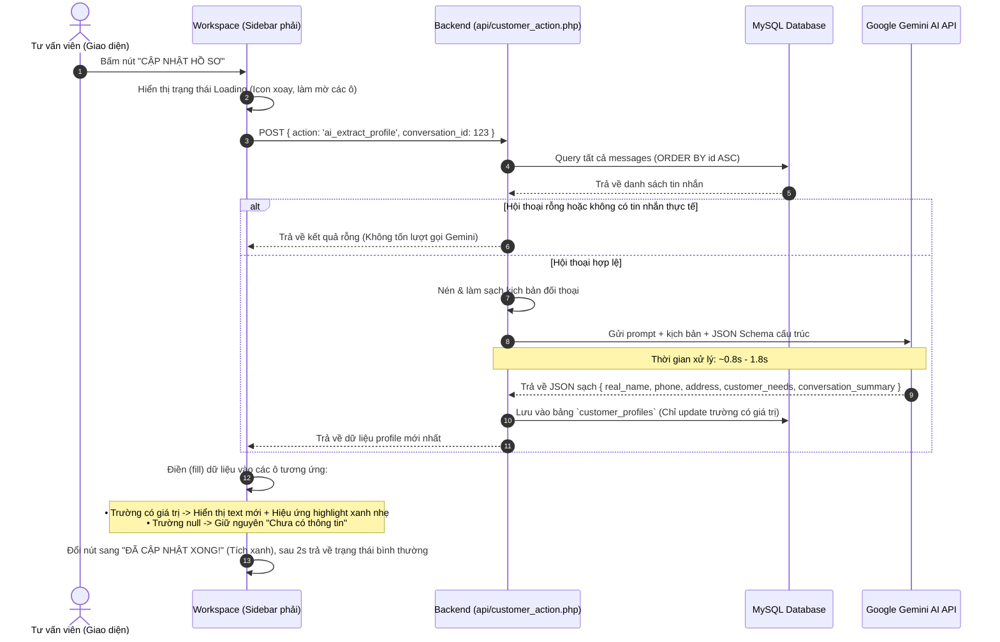

# NGHIÊN CỨU TÍNH KHẢ THI & THIẾT KẾ LUỒNG HOẠT ĐỘNG
## TÍNH NĂNG: TRÍCH XUẤT THÔNG TIN KHÁCH HÀNG CRM TỰ ĐỘNG BẰNG GOOGLE GEMINI AI

> **Ngày thực hiện**: 22/10/2026  
> **Trạng thái**: Nghiên cứu & Thiết kế giải pháp (Chưa lập trình mã nguồn)  
> **Mục tiêu**: Khi bấm "Cập nhật" ở khối Thông tin khách hàng (Sidebar phải), hệ thống sử dụng Google Gemini AI đọc toàn bộ hội thoại từ tin nhắn đầu đến tin nhắn mới nhất, trích xuất thông tin có cấu trúc (Tên thật, SĐT, Địa chỉ, Nhu cầu, Tóm tắt), fill vào đúng các trường mà **tuyệt đối không bịa đặt** thông tin, xử lý siêu nhanh và sử dụng gói **FREE 100%**.

---

## 1. KHẢO SÁT HIỆN TRẠNG GIAO DIỆN & CƠ SỞ DỮ LIỆU

### 1.1. Giao diện Sidebar phải (`views/chat/workspace.php`)
Khối thông tin khách hàng ở Sidebar phải hiện đã có sẵn khung HTML (`zone-sidebar-right`):
1. **Tên thật khách hàng** (`#crmRealName`): Ban đầu hiển thị `"Chưa có thông tin"`.
2. **Số điện thoại** (`#crmPhone`): Ban đầu hiển thị `"Chưa có thông tin"`.
3. **Địa chỉ giao nhận** (`#crmAddress`): Ban đầu hiển thị `"Chưa có thông tin"`.
4. **Sản phẩm quan tâm / Nhu cầu** (`#crmCustomerNeeds`): Ban đầu hiển thị `"Chưa có thông tin"`.
5. **Tóm tắt trao đổi** (`#crmSummary`): Ban đầu hiển thị `"Chưa có tóm tắt"`.
6. **Mốc thời gian dữ liệu** (`#crmDateRange`): `--/--/---- đến --/--/----`.
7. **Nút bấm kích hoạt** (`#btnUpdateProfile`): Nút "CẬP NHẬT HỒ SƠ" nằm ngay phía dưới.

### 1.2. Cơ sở dữ liệu hiện tại
- Bảng `messages`: Lưu trữ toàn bộ lịch sử tin nhắn của cuộc trò chuyện (`id`, `conversation_id`, `sender_type`, `content`, `attachment_url`, `created_at`).
- Bảng `customer_profiles`: Lưu trữ thông tin CRM của khách hàng gắn với `conversation_id` gồm các cột: `real_name`, `phone`, `address`, `customer_needs`, `conversation_summary`, `from_date`, `to_date`, `last_scanned_at`.

---

## 2. ĐÁNH GIÁ TÍNH KHẢ THI CỦA GIẢI PHÁP GEMINI AI

| Tiêu chí | Đánh giá | Chi tiết phân tích kỹ thuật |
| :--- | :---: | :--- |
| **Tính khả thi kỹ thuật** | **100% Khả thi** | Google Gemini cung cấp REST API chuẩn, tích hợp cực kỳ đơn giản qua PHP cURL hoặc Backend Node.js mà không cần cài đặt thư viện nặng nề. |
| **Chi phí (Free Tier)** | **100% Miễn phí (0đ)** | Sử dụng **Google AI Studio Free API Key**:<br>• Giới hạn: **15 requests/phút (RPM)** và **1.500 requests/ngày (RPD)**.<br>• Với quy mô tư vấn viên bấm cập nhật hồ sơ, 1.500 lượt/ngày là hoàn toàn dư giả. |
| **Tốc độ phản hồi (Latency)** | **Siêu nhanh (0.8s - 2.0s)** | Sử dụng model **Gemini 1.5 Flash** hoặc **Gemini 2.0 Flash** chuyên tối ưu cho tác vụ tốc độ cao (Sub-second latency). Xử lý xong và trả kết quả gần như ngay lập tức. |
| **Khả năng hiểu tiếng Việt** | **Xuất sắc** | Gemini Flash nhận diện tiếng Việt cực kỳ chuẩn, bao gồm cả từ viết tắt, cách gõ địa chỉ phường/xã/quận/huyện và các dạng số điện thoại phổ biến ở Việt Nam. |
| **Tính toàn vẹn dữ liệu** | **Tuyệt đối an toàn** | Áp dụng kỹ thuật **Structured Outputs (JSON Schema)** và **Prompt Zero-Hallucination**: Không bao giờ bịa đặt thông tin nếu không có bằng chứng từ tin nhắn. |

---

## 3. TƯ DUY TỐI ƯU CÁCH ĐỌC HỘI THOẠI CHO AI (QUAN TRỌNG)

Để AI đọc nhanh, chính xác, tiết kiệm token và không gây nghẽn hệ thống, phương pháp truy vấn và định dạng dữ liệu được thiết kế tối ưu như sau:

### 3.1. Truy vấn cuộc trò chuyện: Backend DB hay Frontend DOM?
- **Giải pháp tối ưu: Backend truy vấn trực tiếp từ MySQL (`messages` table)**:
  - **Lý do**:
    1. **Toàn vẹn từ đầu đến cuối**: Giao diện Frontend có thể đang phân trang (chỉ tải 20-50 tin gần nhất). Truy vấn từ Database đảm bảo lấy được **chính xác 100% từ tin nhắn số 1 đến tin nhắn mới nhất**.
    2. **Tốc độ cực nhanh**: Truy vấn `SELECT sender_type, content, created_at FROM messages WHERE conversation_id = ? ORDER BY id ASC` có index chỉ mất **1 - 3 mili-giây**.
    3. **Bảo mật tuyệt đối**: Toàn bộ API Key của Gemini nằm an toàn ở Server (PHP), không bao giờ bị lộ ra ngoài trình duyệt (Frontend).
    4. **Băng thông nhẹ**: Frontend chỉ gửi 1 request gọn nhẹ `{ conversation_id: 123 }`, không cần upload toàn bộ mảng tin nhắn lên mạng.

### 3.2. Kỹ thuật Làm sạch & Nén kịch bản (Data Cleansing & Token Minification)
Không gửi raw JSON hay những thông tin thừa cho AI vì sẽ gây chậm và tốn token. Backend sẽ nén cuộc hội thoại thành kịch bản đối thoại tinh gọn:
- **Loại bỏ**: Bỏ qua tin nhắn hệ thống (`SYSTEM`), tin nhắn thông báo tự động, các URL ảnh dài hàng trăm ký tự (thay bằng `[Ảnh đính kèm]`).
- **Định dạng kịch bản nén**:
  ```text
  [Khách hàng]: Em muốn tư vấn mẫu áo thun polo nam màu trắng size XL
  [Tư vấn viên]: Dạ bên em sẵn màu trắng size XL giá 280k ạ
  [Khách hàng]: Ship về 45 Lê Duẩn, P. Bến Nghé, Quận 1, HCM giúp mình nhé. Mình tên Nguyễn Văn Hùng, sđt 0987654321
  [Tư vấn viên]: Dạ vâng shop đã lên đơn cho anh Hùng ạ.
  ```
- **Ước tính Token**: Một cuộc hội thoại bán hàng 30 - 80 tin nhắn sau khi nén chỉ tốn khoảng **400 - 1.000 tokens**. Gemini 1.5/2.0 Flash xử lý 1.000 tokens chỉ trong **chưa đầy 1 giây**!

### 3.3. Cơ chế chống bịa đặt (Zero Hallucination Protocol)
Yêu cầu cốt lõi: *"tuyệt đối ko bịa đặt thông tin cái nào chưa có thông tin thì ko đc fill"*.  
Giải pháp thực hiện thông qua **2 lớp khóa bảo vệ**:

#### Khóa 1: System Instruction nghiêm ngặt
```text
BẠN LÀ CHUYÊN VIÊN TRÍCH XUẤT DỮ LIỆU CRM CHÍNH XÁC 100%.
NHIỆM VỤ: Đọc đoạn hội thoại giữa Khách hàng và Tư vấn viên để bóc tách thông tin khách hàng.

QUY TẮC BẮT BUỘC (QUY TẮC KHÔNG BỊA ĐẶT):
1. Chỉ trích xuất thông tin ĐƯỢC NÊU RÕ RÀNG VÀ CHẮC CHẮN trong cuộc trò chuyện.
2. NẾU KHÔNG CÓ THÔNG TIN hoặc THÔNG TIN KHÔNG RÕ RÀNG -> BẮT BUỘC ĐỂ GIÁ TRỊ LÀ null.
3. TUYỆT ĐỐI KHÔNG SUY ĐOÁN, không điền các giá trị ví dụ (như 0123456789, abc@xyz), không tự bịa tên hoặc địa chỉ.
4. Tên thật (real_name): Chỉ lấy khi khách tự giới thiệu tên mình hoặc nhân viên gọi đích danh tên khách và khách đồng ý. Không lấy nickname chung chung như "Khách Web", "Anh/Chị". Nếu không có -> null.
5. Số điện thoại (phone): Phải là số điện thoại thực tế (9-11 chữ số) xuất hiện trong tin nhắn. Nếu không có -> null.
6. Địa chỉ (address): Phải là địa chỉ giao hàng / nhận hàng cụ thể. Nếu không có -> null.
7. Nhu cầu/Sản phẩm (customer_needs): Tóm tắt ngắn gọn các mặt hàng, dịch vụ hoặc kích cỡ mà khách hàng đang hỏi mua. Nếu chỉ chào hỏi không hỏi sản phẩm -> null.
8. Tóm tắt trao đổi (conversation_summary): 1-2 câu tóm tắt nội dung chính và tình trạng hiện tại của cuộc trò chuyện.
```

#### Khóa 2: Cưỡng chế cấu trúc phản hồi bằng JSON Schema (Structured Outputs)
Thiết lập tham số gọi Gemini API:
- `response_mime_type: "application/json"`
- `response_schema`: Định nghĩa rõ ràng các trường dữ liệu và kiểu dữ liệu (`STRING` hoặc `NULL`).  
Điều này ngăn chặn triệt để tình trạng AI trả lời dông dài, trả về định dạng markdown hay văng chữ thừa. Output 100% là chuỗi JSON sạch để code đọc được ngay.

```json
{
  "real_name": "Nguyễn Văn Hùng",
  "phone": "0987654321",
  "address": "45 Lê Duẩn, P. Bến Nghé, Quận 1, HCM",
  "customer_needs": "Áo thun polo nam màu trắng size XL",
  "conversation_summary": "Khách hàng đặt mua áo polo trắng size XL ship về Quận 1 HCM, shop đã xác nhận lên đơn."
}
```
*(Nếu trường nào không có, AI sẽ trả thẳng `"real_name": null`, `"phone": null`,...)*

---

## 4. THIẾT KẾ LUỒNG HOẠT ĐỘNG TOÀN DIỆN (WORKFLOW)



---

## 5. THIẾT KẾ XỬ LÝ TRẢI NGHIỆM NGƯỜI DÙNG (UI/UX)

1. **Trạng thái ban đầu**:
   - Các trường chưa có dữ liệu luôn hiển thị dạng placeholder màu xám nhạt:
     - Tên thật: `Chưa có thông tin`
     - Số điện thoại: `Chưa có thông tin`
     - Địa chỉ: `Chưa có thông tin`
     - Sản phẩm quan tâm: `Chưa có thông tin`
     - Tóm tắt trao đổi: `Chưa có tóm tắt`
2. **Khi bấm nút "CẬP NHẬT HỒ SƠ"**:
   - Nút `#btnUpdateProfile`:
     - Bị vô hiệu hóa tạm thời (`disabled = true`) để chống click đúp (spam request).
     - Đổi icon xoay tròn: `<i class="fa-solid fa-spinner fa-spin"></i> <span>AI ĐANG PHÂN TÍCH...</span>`.
   - Các ô thuộc tính hiển thị hiệu ứng skeleton pulse nhẹ nhàng (cho người dùng biết AI đang đọc kịch bản).
3. **Khi AI hoàn tất**:
   - Điền dữ liệu vào đúng các ô.
   - Các trường được AI phát hiện mới sẽ có hiệu ứng sáng viền xanh lá (flash highlight) trong 1 giây để tư vấn viên dễ nhận diện thông tin mới.
   - Các trường AI trả về `null` tiếp tục giữ nguyên chữ `Chưa có thông tin` (không bị ghi đè thành chuỗi rỗng hay "undefined").
   - Nút `#btnUpdateProfile` đổi sang `<i class="fa-solid fa-check"></i> <span>ĐÃ CẬP NHẬT XONG!</span>`, sau 1.5 - 2 giây trở lại trạng thái ban đầu.
4. **Khả năng chỉnh sửa thủ công (Manual Edit)**:
   - Các nút "Sửa" kế bên từng trường vẫn hoạt động độc lập, cho phép tư vấn viên chủ động sửa lại bằng tay bất kỳ lúc nào nếu muốn bổ sung hoặc chỉnh sửa theo ý mình.

---

## 6. CHI TIẾT CẤU HÌNH KỸ THUẬT & API GEMINI

### 6.1. Endpoint & Model
- **Endpoint**: `https://generativelanguage.googleapis.com/v1beta/models/gemini-1.5-flash:generateContent?key={API_KEY}`  
  *(hoặc `gemini-2.0-flash` khi Google phát hành chính thức)*
- **Phương thức**: `POST`
- **Headers**: `Content-Type: application/json`

### 6.2. Cấu hình Free API Key
- API Key được lưu bảo mật trong file cấu hình server (`config/ai_config.php` hoặc `.env`), không bao giờ đưa lên frontend.
- Cung cấp cơ chế cấu hình dễ dàng: Cho phép Admin nhập Gemini API Key riêng trong phần Cài đặt hệ thống hoặc file cấu hình PHP.

---

## 7. KẾT LUẬN & ĐỀ XUẤT TRIỂN KHAI

1. **Khả thi 100%**: Giải pháp hoàn toàn khả thi, thực tế, đáp ứng trọn vẹn yêu cầu đọc hội thoại từ đầu đến cuối, trích xuất chính xác và tuyệt đối không bịa đặt.
2. **Chi phí 0đ & Tốc độ cao**: Sử dụng Gemini 1.5 Flash Free Tier với độ trễ phản hồi chỉ khoảng 1 - 2 giây, không phát sinh chi phí vận hành.
3. **Kiến trúc rõ ràng**: Tách bạch logic Backend (bảo mật API key + truy vấn DB) và Frontend (hiệu ứng mượt mà + điền thông tin trực quan).

*(Tài liệu này đã được lưu vào thư mục `docs/nghien_cuu_ai_gemini_trich_xuat_thong_tin_khach_hang.md` để bạn xem xét và phê duyệt trước khi tiến hành code).*
