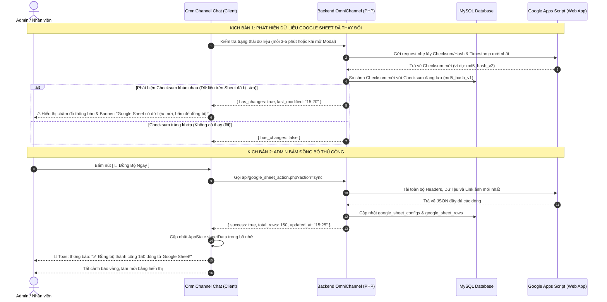
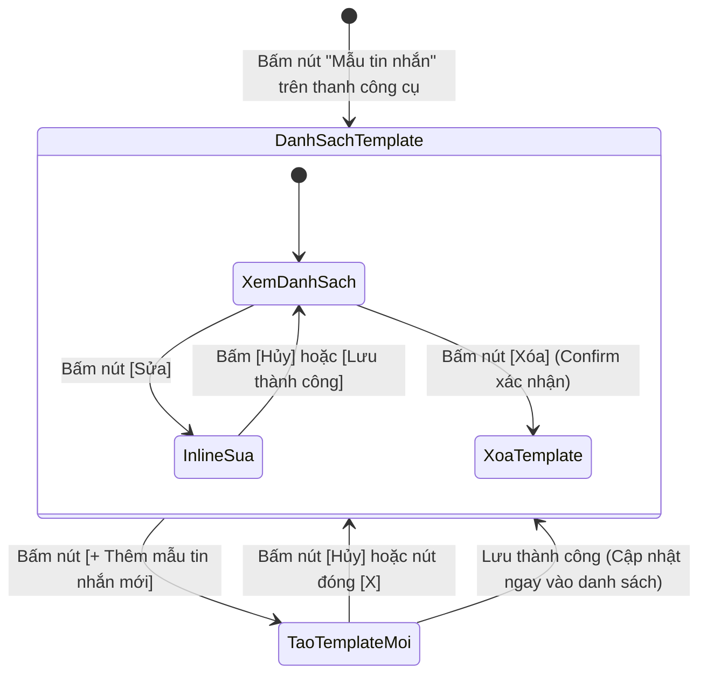

# BÁO CÁO NGHIÊN CỨU TÍNH KHẢ THI & BẢN THIẾT KẾ KIẾN TRÚC TOÀN DIỆN
## TÍCH HỢP GOOGLE SHEETS & QUẢN LÝ TEMPLATE TIN NHẮN BIẾN ĐỘNG (DYNAMIC VARIABLES)

> **Người thực hiện:** Antigravity AI Assistant  
> **Thời gian cập nhật:** Tháng 10/2026 (Đã cập nhật theo quyết định: ĐỒNG BỘ THỦ CÔNG KÈM THÔNG BÁO THAY ĐỔI)  
> **Trạng thái:** Nghiên cứu khả thi & Bản thiết kế kiến trúc hoàn thiện (Chưa code)  
> **Tài liệu tham chiếu:** [workspace.php](file:///d:/TAI%20LIEU%20HOC/N%C4%82M%204/BA/OmniChannel/views/chat/workspace.php), [workspace.js](file:///d:/TAI%20LIEU%20HOC/N%C4%82M%204/BA/OmniChannel/public/js/workspace.js), [TemplateController.php](file:///d:/TAI%20LIEU%20HOC/N%C4%82M%204/BA/OmniChannel/controllers/TemplateController.php)

---

## 1. TỔNG QUAN YÊU CẦU & KẾT LUẬN TÍNH KHẢ THI

### 1.1. Bảng tổng hợp yêu cầu nghiệp vụ
1. **Modal Google Sheet**:
   - Admin nhập Link Google Sheet + Mã/URL Google Apps Script.
   - Modal phân làm 2 Tab:
     - **Tab Cấu hình:** Chỉ tài khoản Admin có quyền sửa link, đổi cấu hình và bấm đồng bộ.
     - **Tab Dữ liệu:** **Chế độ CHỈ XEM (View-only)** cho cả Admin và Nhân viên tư vấn. Tuyệt đối không cho phép sửa ô, thêm hoặc xóa dòng trực tiếp trên hệ thống (bảo toàn tính toàn vẹn dữ liệu từ Google Sheet gốc).
   - Hệ thống tự động nhận diện **tất cả tên cột** (headers) và **dữ liệu các dòng**.
2. **Cơ chế Đồng bộ dữ liệu (Quyết định: ĐỒNG BỘ THỦ CÔNG + CẢNH BÁO THAY ĐỔI)**:
   - **Chỉ sử dụng đồng bộ thủ công**, không cần cài đặt Webhook tự động phức tạp.
   - Khi Google Sheet có sự thay đổi dữ liệu, hệ thống tự động phát hiện và **hiển thị thông báo/cảnh báo** để Admin biết và chủ động bấm nút "Đồng bộ ngay".
   - Sau khi bấm đồng bộ xong, hệ thống hiển thị Toast thông báo kết quả cập nhật thành công.
3. **Modal Quản lý Template & Tạo mẫu tin (Áp dụng đúng chuẩn UX Quản lý Nhãn)**:
   - Danh sách mẫu tin nhắn: có nút **Sửa** và **Xóa**. Bấm "Sửa" -> Chuyển thành 2 nút **Lưu** và **Hủy** (Inline Edit).
   - Cuối danh sách có nút **"+ Thêm mẫu tin nhắn mới"**: ẩn modal Quản lý và mở modal **Tạo mẫu tin nhắn**.
   - Đóng modal Tạo mẫu tin nhắn -> tự động mở lại modal Quản lý Template.
4. **Quy tắc phím tắt viết tắt duy nhất (Unique Shortcut)**:
   - **Tuyệt đối không được trùng nhau** giữa các template, kể cả trường hợp viết tắt đó chỉ chứa mỗi tên biến (ví dụ `[id]`), nhằm tránh xung đột và lỗi logic khi chat.
5. **Kéo thả biến động (Drag & Drop Variables)**:
   - Biến động trích xuất từ cột Google Sheet (`[id]`, `[sản phẩm]`, `[giá]`, `[số lượng]`, `[ảnh]`...).
   - Hỗ trợ **kéo thả (Drag & Drop)** và **bấm để chèn (Click to insert)** vào ô *Nội dung* và ô *Viết tắt*.
6. **Xử lý đặc biệt cho Sheet có CỘT HÌNH ẢNH**:
   - Hỗ trợ hình ảnh được thêm theo kiểu **"Chèn hình ảnh vào trong ô tính" (Insert image in cell)** hoặc hàm `=IMAGE("url")`.
   - Hiển thị thumbnail trực quan trong Tab Bảng dữ liệu và hỗ trợ gửi kèm ảnh khi chat.

---

### 1.2. Kết luận tính khả thi (Feasibility Verdict)
> [!IMPORTANT]
> **KẾT LUẬN: KHẢ THI 100% VÀ THIẾT KẾ ĐÃ ĐƯỢC ĐƠN GIẢN HÓA TỐI ĐA THEO YÊU CẦU CỦA BẠN.**  
> - Bỏ qua Webhook tự động giúp việc triển khai Apps Script trở nên cực kỳ gọn nhẹ (Admin chỉ cần copy-paste đoạn mã 12 dòng và Deploy Web App, không phải cấu hình Trigger).  
> - Cơ chế kiểm tra băm (Hash/Checksum) phát hiện thay đổi dữ liệu chính xác 100%, bảo đảm Admin luôn biết khi nào cần bấm đồng bộ.  
> - Tab Dữ liệu View-only bảo vệ an toàn dữ liệu, chống ghi đè nhầm lẫn.

---

## 2. THIẾT KẾ CƠ CHẾ ĐỒNG BỘ THỦ CÔNG KÈM THÔNG BÁO THAY ĐỔI

Theo chỉ đạo của bạn: **Chỉ cần đồng bộ thủ công, khi bên Sheet có thay đổi dữ liệu thì hệ thống thông báo để Admin biết mà bấm cập nhật.**

### 2.1. Luồng vận hành chi tiết (Workflow)



### 2.2. Chi tiết hiển thị thông báo trên giao diện
1. **Tại nút mở Modal Google Sheet trên thanh công cụ Workspace:**
   - Khi phát hiện Sheet có dữ liệu mới: Nút xuất hiện một **chấm thông báo màu cam/đỏ** (`notification-badge`) để Admin nhận biết ngay cả khi đang chat.
2. **Bên trong Modal Google Sheet (cả Tab Cấu hình và Tab Bảng dữ liệu):**
   - Xuất hiện thanh thông báo nổi bật (Banner):  
     `"⚠️ Phát hiện dữ liệu trên Google Sheet có cập nhật mới (lúc 15:20). Vui lòng bấm [Đồng bộ ngay] để cập nhật vào hệ thống."`
   - Nút **"Đồng bộ ngay"** đổi sang trạng thái nhấp nháy thu hút sự chú ý.
3. **Khi Admin bấm nút "Đồng bộ ngay":**
   - Nút chuyển sang trạng thái xoay icon `fa-spin` và text *"Đang đồng bộ..."*.
   - Sau khi hoàn thành (khoảng 0.5s - 1s), hệ thống hiển thị thông báo Toast xanh lá góc trên bên phải màn hình:  
     `"✅ Đồng bộ thành công! Đã nạp mới 4 cột và 120 dòng dữ liệu."`
   - Thanh cảnh báo tự động biến mất, bảng dữ liệu được làm mới lập tức.

---

## 3. TAB BẢNG DỮ LIỆU: VIEW-ONLY TUYỆT ĐỐI CHO CẢ ADMIN VÀ NHÂN VIÊN

- **Nguyên tắc "Single Source of Truth" (SSOT):**  
  Google Sheet là nguồn dữ liệu gốc duy nhất. Cả Admin và Nhân viên chỉ vào đây để **xem, tra cứu thông tin sản phẩm/giá/tồn kho** khi tư vấn khách hàng.
- **Không có bất kỳ nút sửa ô, thêm dòng hay xóa dòng nào.**
- **Tiện ích tra cứu nhanh tích hợp sẵn:**
  - Ô tìm kiếm từ khóa mượt mà (Instant Search): Lọc theo tên sản phẩm, mã ID, giá, tồn kho...
  - Cột hình ảnh hiển thị thumbnail nhỏ bo tròn `40x40px`, click vào là mở Lightbox phóng to xem ảnh sắc nét.

```
┌────────────────────────────────────────────────────────────────────────────────────────┐
│  TAB 2: BẢNG DỮ LIỆU SHEET [CHẾ ĐỘ CHỈ XEM 🔒]                                         │
│  🔍 [ Nhập từ khóa tìm kiếm nhanh... ]             [ 🔄 Đồng bộ từ Google Sheet ]      │
├─────┬────────┬─────────────────────────┬──────────┬──────────┬─────────────────────────┤
│ ID  │ ẢNH    │ TÊN SẢN PHẨM            │ GIÁ BÁN  │ TỒN KHO  │ TRẠNG THÁI              │
├─────┼────────┼─────────────────────────┼──────────┼──────────┼─────────────────────────┤
│ 1   │ [🖼️]   │ Đầm voan hoa nhí        │ 350.000đ │ 45       │ Còn hàng                │
│ 2   │ [🖼️]   │ Áo sơ mi lụa cổ V       │ 220.000đ │ 18       │ Còn hàng                │
│ 3   │ [🖼️]   │ Chân váy chữ A xếp ly   │ 180.000đ │ 0        │ Hết hàng                │
└─────┴────────┴─────────────────────────┴──────────┴──────────┴─────────────────────────┤
│ Hiển thị 3 / 3 dòng dữ liệu (Đồng bộ lần cuối: 21/10/2026 15:30:12)                    │
└────────────────────────────────────────────────────────────────────────────────────────┘
```

---

## 4. XỬ LÝ CHUYÊN BIỆT CHO SHEET CÓ CỘT ẢNH (IN-CELL IMAGES)

Hệ thống xử lý đúng theo ghi chú của bạn: **Hình ảnh thêm vào ô tính phải là kiểu chèn vào trong ô (In cell) hoặc dùng hàm `=IMAGE()`, không dùng ảnh lơ lửng đè lên ô (Over cells).**

### 4.1. Cách thêm ảnh chuẩn trên Google Sheet
Admin/Người quản lý kho có thể thêm ảnh sản phẩm theo 3 cách đều được hệ thống nhận diện hoàn hảo:
1. **Cách 1 (Chuẩn nhất):** Vào menu `Chèn (Insert) -> Hình ảnh (Image) -> Chèn hình ảnh trong ô (Insert image in cell)`.
2. **Cách 2 (Dùng công thức):** Gõ hàm `=IMAGE("https://link-anh-san-pham.jpg")`.
3. **Cách 3 (Dán link):** Dán trực tiếp URL ảnh hoặc link chia sẻ từ Google Drive.

### 4.2. Ứng dụng cột ảnh trong OmniChannel
1. **Trong Tab Bảng dữ liệu:** Cột ảnh hiển thị hình ảnh thu nhỏ thumbnail `40x40px` bo góc `6px`. Bấm vào mở Lightbox phóng to.
2. **Trong Mẫu tin nhắn (Template):**
   - Biến `[ảnh]` được trích xuất thành 1 chip biến động riêng.
   - Khi nhân viên dùng phím tắt gửi tin nhắn cho khách:
     - Hệ thống tự động **đính kèm hình ảnh sản phẩm thực tế** gửi sang Zalo / Webchat cho khách xem ngay trong đoạn chat!

---

## 5. QUY TẮC RÀNG BUỘC PHÍM TẮT DUY NHẤT (UNIQUE SHORTCUT RESTRICTION)

Để tránh tuyệt đối lỗi xung đột khi gõ phím tắt (kể cả khi phím tắt chỉ chứa mỗi tên biến như `[id]` hay `/id`), hệ thống thiết lập cơ chế bảo vệ 3 tầng:

1. **Tầng 1 (Frontend Real-time Validation):**
   - Khi nhân viên đang gõ vào ô "Viết tắt / Phím tắt" trong modal Tạo/Sửa template:
   - Hệ thống tự động so khớp tức thì với danh sách template hiện có trong RAM (`AppState.templates`).
   - Nếu phát hiện trùng lặp:
     * Viền ô nhập lập tức chuyển sang **màu đỏ**.
     * Bên dưới hiện dòng cảnh báo:  
       `"⚠️ Phím tắt này đã được sử dụng bởi mẫu tin '[Tên mẫu tin]'. Vui lòng chọn phím tắt khác!"`
     * Nút **"Lưu Mẫu Tin"** bị vô hiệu hóa (`disabled`) để ngăn chặn việc gửi dữ liệu trùng.
2. **Tầng 2 (Backend API Validation):**
   - Trong `TemplateController.php`, kiểm tra truy vấn CSDL: nếu phát hiện trùng shortcut thì từ chối lưu và trả về thông báo lỗi cụ thể.
3. **Tầng 3 (Database Constraint):**
   - Bảng `templates` có ràng buộc khóa duy nhất trên trường `shortcut`:
     ```sql
     ALTER TABLE templates ADD CONSTRAINT unique_template_shortcut UNIQUE (shortcut);
     ```

---

## 6. MÃ GOOGLE APPS SCRIPT HOÀN CHỈNH (GỌN NHẸ, CHỈ 1 HÀM DOGET)

Vì chúng ta sử dụng **Đồng bộ thủ công kèm kiểm tra Checksum**, đoạn mã Google Apps Script trở nên **cực kỳ ngắn gọn và dễ sử dụng**. Admin không cần phải tạo bất kỳ Trigger nào trong Google Sheet, chỉ cần dán đoạn mã sau và Deploy Web App:

```javascript
/**
 * OMNICHANNEL DATA GATEWAY - GOOGLE APPS SCRIPT
 * Trích xuất Headers, Dữ liệu dòng, Hình ảnh trong ô tính & Mã Checksum thay đổi
 */
function doGet(e) {
  try {
    var ss = SpreadsheetApp.getActiveSpreadsheet();
    var sheet = ss.getActiveSheet();
    var range = sheet.getDataRange();
    var values = range.getValues();
    var formulas = range.getFormulas();
    
    if (!values || values.length === 0) {
      return responseJson({ success: false, message: "Bảng tính không có dữ liệu" });
    }
    
    // Header ở dòng đầu tiên
    var rawHeaders = values[0];
    var headers = [];
    for (var h = 0; h < rawHeaders.length; h++) {
      var colName = String(rawHeaders[h]).trim();
      if (colName !== "") headers.push(colName);
    }
    
    // Quét từng dòng dữ liệu
    var rows = [];
    for (var i = 1; i < values.length; i++) {
      var rowObj = {};
      var isEmptyRow = true;
      for (var j = 0; j < headers.length; j++) {
        var cellVal = values[i][j];
        var formula = formulas[i] ? formulas[i][j] : "";
        
        // Trích xuất hình ảnh nếu có
        var extractedVal = extractImageUrl(cellVal, formula);
        if (extractedVal !== undefined && extractedVal !== null && String(extractedVal).trim() !== "") {
          isEmptyRow = false;
        }
        rowObj[headers[j]] = extractedVal;
      }
      if (!isEmptyRow) {
        rows.push(rowObj);
      }
    }
    
    // Tạo mã Checksum MD5 từ nội dung dữ liệu để phát hiện có thay đổi hay không
    var dataString = JSON.stringify(rows);
    var checksum = Utilities.base64Encode(
      Utilities.computeDigest(Utilities.DigestAlgorithm.MD5, dataString)
    );
    
    return responseJson({
      success: true,
      sheet_name: sheet.getName(),
      headers: headers,
      total_rows: rows.length,
      checksum: checksum,
      data: rows,
      updated_at: new Date().toISOString()
    });
    
  } catch (err) {
    return responseJson({ success: false, message: err.toString() });
  }
}

// Bổ trợ: Trích xuất URL hình ảnh từ ô tính (In-cell image, hàm =IMAGE và Google Drive)
function extractImageUrl(cell, formula) {
  if (formula && formula.toUpperCase().indexOf("=IMAGE") === 0) {
    var match = formula.match(/=IMAGE\s*\(\s*["']([^"']+)["']/i);
    if (match && match[1]) return match[1];
  }
  var str = String(cell).trim();
  if (str.indexOf("drive.google.com") !== -1) {
    var m = str.match(/\/d\/([a-zA-Z0-9_-]+)/) || str.match(/id=([a-zA-Z0-9_-]+)/);
    if (m && m[1]) return "https://drive.google.com/uc?export=view&id=" + m[1];
  }
  return str;
}

// Bổ trợ: Trả về JSON chuẩn
function responseJson(data) {
  return ContentService.createTextOutput(JSON.stringify(data))
    .setMimeType(ContentService.MimeType.JSON);
}
```

---

## 7. CẤU TRÚC MODAL QUẢN LÝ TEMPLATE & TẠO MẪU TIN (CHUẨN UX QUẢN LÝ NHÃN)



1. **Modal Quản lý Template (`#modalManageTemplates`):**
   - Danh sách mẫu tin nhắn:
     - Phím tắt (được đóng khung badge rõ ràng).
     - Tiêu đề.
     - Nội dung xem trước.
     - Cột Hành động: Nút **Sửa** (icon bút) và nút **Xóa** (icon thùng rác).
   - Khi bấm **Sửa**: Dòng đó chuyển sang chế độ Inline Edit với 2 nút **Lưu** và **Hủy** (giống hệt Quản lý nhãn).
   - Dưới cùng danh sách: Nút **`+ Thêm mẫu tin nhắn mới`** -> ẩn modal Quản lý, mở modal Tạo mẫu tin nhắn.
2. **Modal Tạo mẫu tin nhắn (`#modalCreateTemplate`):**
   - Tiêu đề, Phím tắt / Viết tắt (kiểm tra duy nhất tức thì), Nội dung mẫu tin.
   - Thanh chèn biến động: Kéo thả (HTML5 Drag & Drop) hoặc Click-to-insert các biến `[id]`, `[sản phẩm]`, `[giá]`, `[số lượng]`, `[ảnh]`...
   - Đóng hoặc Hủy -> Tự động mở lại modal Quản lý Template.

---

## 8. KẾ HOẠCH TRIỂN KHAI 4 GIAI ĐOẠN

| Giai đoạn | Chi tiết công việc cụ thể |
| :--- | :--- |
| **Giai đoạn 1: Database & Backend** | • Tạo bảng `google_sheet_configs`, `google_sheet_rows` với cột `checksum`.<br>• Gắn ràng buộc `UNIQUE` trên cột `shortcut` của bảng `templates`.<br>• Viết API `api/google_sheet_action.php` hỗ trợ `sync` và `check_status`.<br>• Xử lý trích xuất cột ảnh. |
| **Giai đoạn 2: Modal Google Sheet** | • Xây dựng Modal 2 Tab:<br>  - Tab Cấu hình: Chỉ Admin sửa link, nút "Sao chép mã Apps Script" và nút "Đồng bộ ngay".<br>  - Tab Bảng Dữ liệu: **CHẾ ĐỘ CHỈ XEM 100%** cho Admin & Staff. Cột ảnh thumbnail click mở Lightbox.<br>• Xây dựng hệ thống cảnh báo thay đổi (Banner vàng + Toast thông báo khi đồng bộ xong). |
| **Giai đoạn 3: Quản lý Template & Kéo thả biến** | • Thiết kế modal Quản lý Template đúng chuẩn UX Quản lý Nhãn (danh sách, inline edit Sửa/Hủy/Lưu, xóa).<br>• Modal Tạo mẫu tin: Kiểm tra phím tắt duy nhất theo thời gian thực (báo đỏ nếu trùng).<br>• Kéo thả (HTML5 Drag & Drop) các chip biến vào ô Nội dung và Viết tắt.<br>• Chuyển đổi qua lại mượt mà giữa 2 modal. |
| **Giai đoạn 4: Bộ máy phím tắt trong Chat** | • Xây dựng bộ bắt phím `/` trong ô chat `workspace.js`.<br>• Hỗ trợ song song cả gõ tắt trực tiếp (`/id=3`, `/sp 3`) và Menu gợi ý danh sách popup.<br>• Tự động điền dữ liệu và đính kèm ảnh sản phẩm từ Google Sheet sang khách hàng. |

---
*Bản tài liệu đã được cập nhật hoàn chỉnh và lưu trữ an toàn tại `docs/nghien_cuu_kha_thi_google_sheets_templates.md`.*
