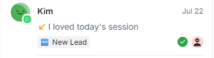

1. xây dựng api tạo webchat và tôi sẽ gắn api này sẽ có widget ở web tôi đang có sẵn. khi người dùng nhắn tin bằng widget ở web đó tin nhắn sẽ đổ về danh sách chat ở phần mềm omnichannel này.
2. giảm scope chỉ làm webchat, zalo (cá nhân - zcajs), fb (cá nhân - tìm kiếm cho tôi repo hỗ trợ unofficial, tài khoản cá nhân)
3. sidebar trái: tìm kiếm theo tên khách hàng, nội dung tin nhắn chỉ vậy. ở tab thì sẽ có tất cả -> tất cả tin nhắn khách đổ về từ các kênh theo thời gian từ mới đến cũ, của tôi -> tất cả tin nhắn khách được hệ thống phân chia cho, chưa đọc -> sẽ có dropdown v bên cạnh nó, click vào sẽ có tất cả và của tôi, tất cả thì là các tin nhắn chưa đọc của toàn bộ, của tôi thì là tất cả các tin nhắn chưa đọc của của tôi. sẽ có 1 dropdown nhãn phân loại hội thoại ở đây sẽ có tên là phân loại, là các nhãn mà nhân viên tạo ra rồi gắn cho nhân viên đấy, nhãn có màu, có thể tùy chọn thỏa thích. bỏ badge đếm hội thoại và ctrl k, tiêu đề Hộp Thư Hội Thoại nữa. ngoài ra còn có lọc theo kênh nữa
4. sidebar trái phần danh sách tin nhắn mỗi khung sẽ thiết kế theo mẫu của respondio như dưới đây

