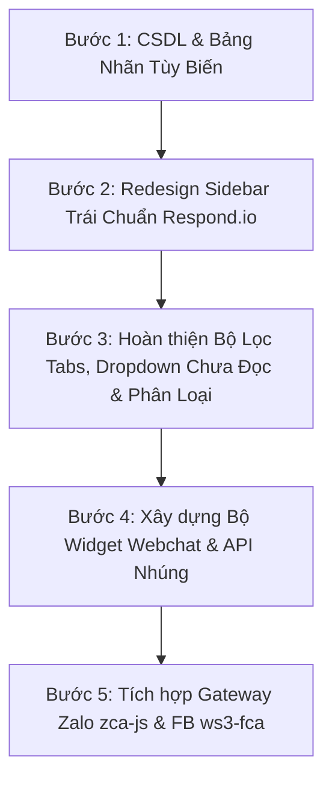

# KẾ HOẠCH TRIỂN KHAI VÀ THI CÔNG TUẦN TỰ (OMNICHANNEL WORKSPACE)
> **Căn cứ tài liệu**: `docs/plan.md` & Thiết kế mẫu Respond.io (`docs/image/plan/1792396447265.png`)  
> **Nguyên tắc thực hiện**: Thi công tuần tự từng giai đoạn theo lệnh điều phối (order) của người dùng; **chưa viết code** cho đến khi kế hoạch được phê duyệt.

---

## I. TỔNG QUAN YÊU CẦU & THỐNG NHẤT PHẠM VI (SCOPE)

### 1. Thu hẹp kênh kết nối (3 kênh trọng tâm)
*   **Webchat**: Tự xây dựng API và bộ Widget JavaScript nhúng vào trang web sẵn có của khách hàng.
*   **Zalo cá nhân**: Kết nối không chính thức qua thư viện Node.js `zca-js` (đăng nhập bằng mã QR / Cookie Zalo).
*   **Facebook cá nhân (Unofficial)**: Sử dụng thư viện Node.js dựa trên cơ chế AppState/Cookie (khuyến nghị `ws3-fca` hoặc `fca-unofficial`), lắng nghe qua giao thức MQTT nội bộ của Messenger.
*   *Loại bỏ khỏi scope tích cực*: Shopee và TikTok (giữ cấu trúc cơ bản nhưng không ưu tiên tích hợp luồng tin).

---

## II. ĐẶC TẢ CHI TIẾT THEO TỪNG HẠNG MỤC (PLAN.MD)

### Hạng mục 1: Sidebar Trái - Bộ lọc & Tìm kiếm
*   **Ô tìm kiếm**: Tinh gọn, chỉ tìm kiếm chính xác theo **Tên khách hàng** (`sender_name`) và **Nội dung tin nhắn** (`last_message` / nội dung đoạn chat).
*   **Loại bỏ các thành phần rườm rà**:
    *   Bỏ toàn bộ Badge đếm số lượng hội thoại trên các tab.
    *   Bỏ gợi ý phím tắt `Ctrl K`.
    *   Bỏ tiêu đề text `Hộp Thư Hội Thoại`.
*   **Hệ thống Phân loại Tab & Dropdown**:
    1.  **Tab "Tất cả"**: Toàn bộ tin nhắn khách đổ về từ tất cả các kênh (Webchat, Zalo, Facebook), sắp xếp theo thời gian từ mới nhất đến cũ nhất.
    2.  **Tab "Của tôi"**: Các tin nhắn được hệ thống tự động gán hoặc điều phối cho chính nhân viên đang đăng nhập.
    3.  **Tab "Chưa đọc" + Dropdown mũi tên `v`**:
        *   Khi bấm vào mũi tên `v`, hiển thị menu gồm 2 tùy chọn:
            *   *Tất cả*: Danh sách toàn bộ tin nhắn chưa đọc của cả hệ thống.
            *   *Của tôi*: Chỉ lấy các tin nhắn chưa đọc thuộc quyền phụ trách của tôi.
*   **Dropdown "Phân loại" (Custom Labels/Tags)**:
    *   Hiển thị danh sách các nhãn phân loại do nhân viên tự tạo.
    *   Mỗi nhãn gồm: Tên nhãn + Mã màu sắc tùy chọn (Color Picker / Bảng màu linh hoạt).
    *   Có chức năng thêm mới nhãn nhanh, đổi màu nhãn, gán nhãn cho hội thoại bất kỳ.
*   **Bộ lọc theo kênh**: Dropdown lọc nhanh theo nguồn kênh: `Tất cả kênh`, `Webchat`, `Zalo`, `Facebook`.

---

### Hạng mục 2: Thiết Kế Khung Thẻ Hội Thoại Chuẩn Respond.io
*Căn cứ trực tiếp theo ảnh mẫu `docs/image/plan/1792396447265.png`:*

```
+-------------------------------------------------------------+
| (Avatar)   Khách Hàng (Tên in đậm)                   Jul 22 |
|   [Icon]   ↙ I loved today's session (Trích đoạn chat)      |
|            [🟦 New Lead]                              (✓) 👤 |
+-------------------------------------------------------------+
```

1.  **Cụm Avatar & Kênh (Bên trái)**:
    *   Avatar tròn đại diện của khách.
    *   Huy hiệu logo kênh nhỏ nằm đè ở góc dưới bên phải avatar (Facebook xanh lam, Zalo xanh dương, Webchat xanh lá).
2.  **Dòng 1 (Tiêu đề)**:
    *   **Tên khách hàng**: Font đậm nét, rõ ràng, dễ đọc.
    *   **Thời gian**: Căn góc trên bên phải (vd: `14:20`, `Hôm qua`, `Jul 22`).
3.  **Dòng 2 (Nội dung tin nhắn & Hướng)**:
    *   **Icon hướng tin**: Mũi tên cam `↙` biểu thị khách nhắn đến; biểu tượng hai dấu tick xanh `✓✓` khi nhân viên đã trả lời.
    *   **Snippet tin nhắn**: Rút gọn 1 dòng với font màu xám trung tính, chữ đậm hơn nếu chưa đọc.
4.  **Dòng 3 (Nhãn & Nhân sự phụ trách)**:
    *   **Pill nhãn phân loại (Bên trái)**: Bo góc nhẹ, hiển thị icon danh mục + Tên nhãn (vd: `New Lead`, `Đã chốt`, `Cần tư vấn size`) với màu nền và màu chữ tương ứng với màu nhãn đã cấu hình.
    *   **Trạng thái & Assignee (Bên phải)**:
        *   Icon checkmark tròn xanh lá `(✓)` biểu thị hội thoại đã xử lý / đang hoạt động.
        *   Avatar tròn nhỏ của nhân viên đang phụ trách hội thoại (hoặc icon người dùng mờ nếu chưa gán).

---

### Hạng mục 3: Hệ Thống Webchat Widget & API Nhúng Sẵn Có
1.  **Kiến trúc Widget Client (`widget.js`)**:
    *   Xây dựng dưới dạng một tệp script độc lập nhẹ (< 30KB), không phụ thuộc thư viện bên ngoài.
    *   Tự động chèn nút bấm tròn (Floating Action Button) ở góc dưới bên phải trang web.
    *   Khi click mở popup trò chuyện mượt mà (Modern Chat Window):
        *   Khách hàng chỉ cần nhập tên / số điện thoại (hoặc chat ẩn danh tự sinh `visitor_token`).
        *   Khung chat trực quan, có âm thanh thông báo và lưu trạng thái phiên trò chuyện vào `localStorage`.
2.  **Webchat API Backend (PHP)**:
    *   Endpoint `api/webchat_endpoint.php`:
        *   `action=init_session`: Khởi tạo phiên khách truy cập, sinh hoặc nối lại `conversation_id`.
        *   `action=send_message`: Nhận tin nhắn từ khách trên website -> lưu vào bảng `messages` và `conversations` (channel = `WEBCHAT`).
        *   `action=get_updates`: Polling / Long-polling nhận phản hồi từ nhân viên tư vấn về cho khách hàng trên website.

---

### Hạng mục 4: Nghiên Cứu Thư Viện Facebook & Zalo Cá Nhân (Unofficial)

#### 1. Zalo cá nhân (`zca-js`)
*   **Thư viện**: `zca-js` (Zalo Chat API for JavaScript).
*   **Cơ chế hoạt động**:
    *   Khởi chạy server Node.js (Gateway).
    *   Sinh mã QR để quét qua ứng dụng Zalo trên điện thoại.
    *   Lưu thông tin session cookie / key để tự động đăng nhập lại.
    *   Bắt sự kiện tin nhắn qua listener của `zca-js`, đóng gói JSON đẩy Webhook về endpoint PHP `api/webhook_receive.php`.
    *   Nhận yêu cầu gửi tin từ PHP (qua cURL sang Node.js) để gửi tin nhắn đến Zalo của khách.

#### 2. Facebook cá nhân (Unofficial)
*   **Thư viện đề xuất**: `ws3-fca` (hoặc `fca-unofficial`).
*   **Cơ chế hoạt động**:
    *   Sử dụng tệp `appstate.json` (chứa session cookie trích xuất từ trình duyệt như `c_user`, `xs`).
    *   Kết nối trực tiếp vào giao thức MQTT nội bộ của Facebook Messenger.
    *   Bắt sự kiện tin nhắn đến và chuyển tiếp về OmniChannel PHP.
    *   Hỗ trợ gửi tin nhắn văn bản, ảnh, sticker từ hệ thống phản hồi lại khách.
*   **Khuyến cáo an toàn**:
    *   Tài khoản Facebook cá nhân dễ gặp rủi ro checkpoint nếu đổi IP liên tục hoặc gửi tần suất quá dày đặc. Do đó, cần cơ chế delay ngẫu nhiên (1 - 3 giây) giữa các tin gửi và bảo mật tuyệt đối tệp `appstate.json`.

---

## III. LỘ TRÌNH THỰC HIỆN TUẦN TỰ (ROADMAP)

Dưới đây là các bước tuần tự được chia nhỏ để bạn có thể yêu cầu (order) thực hiện từng phần một:



### BƯỚC 1: Cập nhật CSDL (Nhãn tùy biến & Trạng thái đọc)
*   Tạo bảng `labels` (id, name, color, created_by, created_at).
*   Tạo bảng liên kết `conversation_labels` (conversation_id, label_id).
*   Thêm cờ `is_read` hoặc trạng thái đọc theo nhân viên để phục vụ tab **Chưa đọc**.
*   *Kết quả đầu ra*: Script SQL cập nhật an toàn, không lỗi khóa ngoại.

### BƯỚC 2: Tái cấu trúc Giao diện Sidebar Trái theo mẫu Respond.io
*   Xóa bỏ: Badge đếm số, gợi ý `Ctrl K`, tiêu đề văn bản `Hộp Thư Hội Thoại`.
*   Thiết kế lại toàn bộ thẻ hội thoại HTML/CSS theo mẫu ảnh `1792396447265.png`:
    *   Avatar tròn + Huy hiệu kênh góc dưới.
    *   Tên khách (đậm) + Thời gian nhận tin (phải trên).
    *   Icon chiều tin nhắn (`↙` / `✓✓`) + Trích đoạn chat.
    *   Pill nhãn phân loại tùy biến màu sắc + Checkmark tròn + Avatar nhân viên phụ trách.

### BƯỚC 3: Xử lý Logic Bộ Lọc (Tabs, Dropdown Chưa Đọc, Phân Loại, Kênh)
*   Thanh tìm kiếm: Viết hàm lọc theo `sender_name` và `content`.
*   Tab "Tất cả": Load toàn bộ hội thoại từ mới đến cũ.
*   Tab "Của tôi": Lọc hội thoại theo `assigned_user_id`.
*   Tab "Chưa đọc": Tích hợp dropdown toggle `v` lựa chọn giữa `Tất cả` và `Của tôi`.
*   Dropdown "Phân loại": Menu hiển thị danh sách nhãn, modal thêm nhãn mới với bảng chọn màu, gán nhãn cho hội thoại.
*   Bộ lọc Kênh: Lọc theo Webchat, Zalo, Facebook.

### BƯỚC 4: Xây dựng Webchat Widget & API Nhúng Độc Lập
*   Viết file nhúng `public/widget/webchat.js` (hoặc CDN script) để gắn vào website bất kỳ qua 1 dòng `<script>`.
*   Xây dựng giao diện bubble chat thu gọn và cửa sổ chat nổi bật, responsive trên cả mobile và desktop.
*   Hoàn thiện API backend `api/webchat_endpoint.php` để lưu trữ và đẩy tin nhắn vào workspace.

### BƯỚC 5: Tích hợp Gateway Zalo Cá Nhân (`zca-js`) & Facebook Cá Nhân (`ws3-fca`)
*   Cấu hình Node.js Gateway với module `zca-js` (hỗ trợ login QR).
*   Cấu hình module `ws3-fca` (hỗ trợ nạp `appstate.json` của Facebook cá nhân).
*   Kết nối Webhook đẩy về hệ thống OmniChannel để nhân viên chat tập trung trên một màn hình duy nhất.

---

## IV. BƯỚC KẾ TIẾP CỦA BẠN
Kế hoạch trên đã bao quát 100% các yêu cầu từ file `plan.md` và hình ảnh mẫu Respond.io.  
👉 **Xin mời bạn xem qua và ra lệnh (order) bước bạn muốn bắt đầu trước!**
