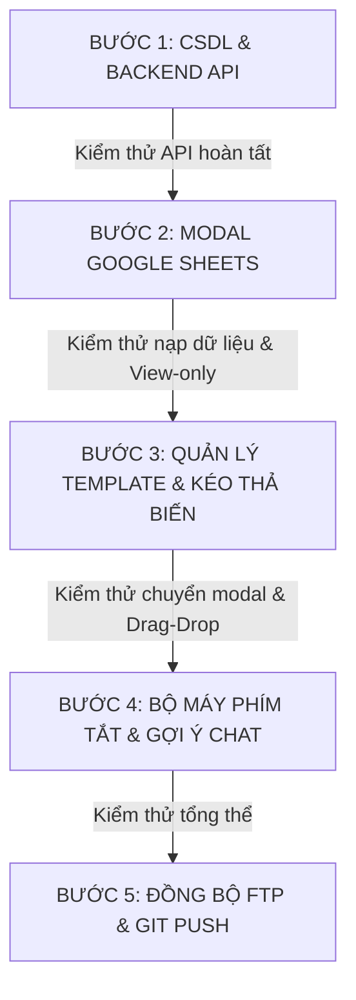

# KẾ HOẠCH TRIỂN KHAI TỪNG BƯỚC: TÍCH HỢP GOOGLE SHEETS & QUẢN LÝ TEMPLATE BIẾN ĐỘNG
> **Mã kế hoạch:** `PLAN-GSHEET-TPL-2026`  
> **Tài liệu tham chiếu:** [docs/nghien_cuu_kha_thi_google_sheets_templates.md](file:///d:/TAI%20LIEU%20HOC/N%C4%82M%204/BA/OmniChannel/docs/nghien_cuu_kha_thi_google_sheets_templates.md)  
> **Nguyên tắc thực hiện:** "Làm cẩn thận từng bước, kiểm thử chặt chẽ từng giai đoạn, không làm đứt gãy tính năng đang chạy".

---

## I. LỘ TRÌNH 4 BƯỚC THỰC HIỆN (PHASED EXECUTION)

---

## II. CHI TIẾT TỪNG BƯỚC VÀ TIÊU CHÍ NGHIỆM THU (ACCEPTANCE CRITERIA)

### 📌 BƯỚC 1: CƠ SỞ DỮ LIỆU & BACKEND APIS
**Mục tiêu:** Xây dựng nền tảng dữ liệu vững chắc, bảo đảm lưu trữ cấu hình Sheet, các dòng dữ liệu, mã băm Checksum và quản lý template an toàn.

1. **Cơ sở dữ liệu (Database Migration):**
   - Viết migration tạo bảng `google_sheet_configs`:
     * `id`, `sheet_url`, `script_url`, `sheet_name`, `columns_json`, `checksum`, `last_synced_at`, `synced_by_user_id`.
   - Viết migration tạo bảng `google_sheet_rows`:
     * `id`, `config_id`, `row_index`, `row_data_json`.
   - Cập nhật bảng `templates`:
     * Thêm ràng buộc `UNIQUE KEY (shortcut)` để bảo đảm không bao giờ bị trùng phím tắt.
     * Thêm cột `title`, `variables_json`.
2. **Backend API Google Sheet (`api/google_sheet_action.php`):**
   - `action=save_config`: Lưu link sheet, script URL (chỉ Admin).
   - `action=sync`: Gọi sang Google Apps Script, lấy toàn bộ dữ liệu, cập nhật bảng CSDL, cập nhật `checksum`, trả về danh sách cột và số dòng (chỉ Admin).
   - `action=check_status`: So sánh nhẹ `checksum` hiện tại để phát hiện Sheet có thay đổi dữ liệu hay không.
   - `action=get_data`: Lấy dữ liệu bảng tính để hiển thị cho cả Admin và Staff (View-Only).
3. **Backend API Template (`api/template_action.php` & `TemplateController.php`):**
   - Nâng cấp `get_list`: Trả về danh sách template kèm thông tin người tạo.
   - Nâng cấp `create` & `update`: Kiểm tra phím tắt duy nhất trước khi lưu (báo lỗi cụ thể nếu trùng).
   - `delete`: Xóa mẫu tin nhắn theo ID.
4. **Tiêu chí nghiệm thu Bước 1:**
   - [ ] Migration chạy thành công không có lỗi syntax.
   - [ ] API `google_sheet_action.php` hoạt động tốt với các request test.
   - [ ] API `template_action.php` chặn thành công khi cố tình tạo 2 template cùng shortcut.

---

### 📌 BƯỚC 2: MODAL GOOGLE SHEETS (TAB CẤU HÌNH & TAB DỮ LIỆU VIEW-ONLY)
**Mục tiêu:** Cung cấp giao diện trực quan cho Admin cấu hình và cả Admin lẫn Nhân viên tra cứu dữ liệu bảng tính.

1. **Nút mở Modal trên Topbar Workspace:**
   - Thêm nút **Google Sheets** (Icon bảng tính màu xanh lá đặc trưng Google Sheets) cạnh nút Quản lý nhãn và Mẫu tin nhắn.
   - Có vị trí gắn **Chấm thông báo màu cam/đỏ** (`notification-badge`) khi phát hiện Sheet có dữ liệu mới.
2. **Tab 1: Cấu hình (Chỉ dành cho Admin):**
   - Input nhập Google Sheet URL & Web App URL của Apps Script.
   - Hộp hướng dẫn 3 bước thao tác kèm nút **"Sao chép mã Apps Script mẫu"** (Copy 1-click).
   - Nút **"Đồng bộ ngay" (Sync Now)**:
     * Hiển thị trạng thái đang đồng bộ (`fa-spin`).
     * Khi xong hiện Toast thông báo thành công: *"✅ Đồng bộ thành công 120 dòng từ Google Sheet"*.
   - Phân quyền: Nếu tài khoản là Nhân viên thường, các ô input bị vô hiệu hóa `disabled` kèm thông báo *"Chỉ Admin có quyền chỉnh sửa cấu hình liên kết"*.
3. **Tab 2: Bảng dữ liệu Sheet (CHẾ ĐỘ CHỈ XEM 100%):**
   - Cả Admin và Nhân viên đều xem được.
   - Bảng hiển thị tự động sinh các cột theo headers của Sheet (`id`, `sản phẩm`, `giá`, `số lượng`...).
   - **Xử lý cột ảnh:** Nếu là cột ảnh, hiển thị hình ảnh thu nhỏ `40x40px` bo tròn mượt mà, bấm vào mở Lightbox phóng to.
   - Ô tìm kiếm nhanh (Instant Filter) giúp lọc dữ liệu ngay lập tức.
   - Banner cảnh báo vàng xuất hiện khi Sheet có dữ liệu mới: *"⚠️ Google Sheet có cập nhật mới, bấm [Đồng bộ ngay] để cập nhật."*
4. **Tiêu chí nghiệm thu Bước 2:**
   - [ ] Modal mở/đóng mượt mà, chuyển tab nhạy.
   - [ ] Nhân viên thường không thể sửa cấu hình.
   - [ ] Bảng dữ liệu hoàn toàn chỉ xem, không thể sửa ô hay xóa dòng.
   - [ ] Ảnh thumbnail hiển thị chuẩn, click phóng to hoạt động.

---

### 📌 BƯỚC 3: MODAL QUẢN LÝ TEMPLATE & TẠO MẪU TIN (KÉO THẢ BIẾN ĐỘNG)
**Mục tiêu:** Xây dựng trải nghiệm quản lý mẫu tin nhắn chuẩn xác theo đúng mô hình Quản lý Nhãn, hỗ trợ kéo thả biến động từ Sheet.

1. **Modal Quản lý Template (`#modalManageTemplates`):**
   - Danh sách mẫu tin hiển thị: Phím tắt (Badge), Tiêu đề, Nội dung rút gọn, Người tạo.
   - Nút hành động: **Sửa** (icon bút) và **Xóa** (icon thùng rác).
   - Khi bấm "Sửa": Chuyển hàng đó thành chế độ **Inline Edit** với 2 nút **Lưu** và **Hủy** (giống hệt Quản lý nhãn).
   - Nút bấm cuối danh sách: **`+ Thêm mẫu tin nhắn mới`** -> Ẩn modal Quản lý, mở modal Tạo mẫu tin nhắn.
2. **Modal Tạo mẫu tin nhắn (`#modalCreateTemplate`):**
   - Các trường nhập liệu:
     * Tiêu đề mẫu tin.
     * Viết tắt / Phím tắt: **Kiểm tra trùng lặp theo thời gian thực (Real-time Validation)**. Nếu trùng với bất kỳ template nào đã có -> Viền đỏ lập tức + thông báo lỗi bên dưới + vô hiệu hóa nút Lưu.
     * Nội dung mẫu tin (Textarea).
   - **Khu vực "Chèn biến động":**
     * Tự động sinh các chip biến từ các cột của Google Sheet: `[+ id]`, `[+ sản phẩm]`, `[+ giá]`, `[+ số lượng]`, `[+ ảnh]`...
     * **Tính năng Kéo thả (HTML5 Drag & Drop):** Kéo thả chip biến thả trực tiếp vào ô Nội dung hoặc ô Viết tắt.
     * **Tính năng Click-to-insert:** Bấm vào chip biến sẽ chèn ngay tại vị trí con trỏ chuột.
   - **Luồng đóng modal:** Bấm Hủy hoặc nút Đóng (X) -> Tự động mở lại modal Quản lý Template.
3. **Tiêu chí nghiệm thu Bước 3:**
   - [ ] Luồng chuyển đổi 2 modal qua lại mượt mà, không bị kẹt hay mất form.
   - [ ] Sửa inline và Xóa hoạt động ổn định, cập nhật danh sách ngay không cần F5.
   - [ ] Kiểm tra phím tắt duy nhất báo đỏ chính xác khi gõ trùng.
   - [ ] Kéo thả biến vào ô nội dung hoạt động trơn tru.

---

### 📌 BƯỚC 4: BỘ MÁY PHÍM TẮT & GỢI Ý THÔNG MINH KHI CHAT
**Mục tiêu:** Giúp nhân viên tư vấn gõ phím tắt hoặc chọn nhanh sản phẩm để điền toàn bộ nội dung mẫu tin trong 0ms.

1. **Bộ bắt phím `/` trong ô nhập tin nhắn (`workspace.js`):**
   - Khi nhân viên gõ `/`: Nhận diện ý định sử dụng phím tắt mẫu tin.
2. **Hỗ trợ song song cả 2 cách:**
   - **Cách 1: Gõ tắt trực tiếp:** Nhân viên gõ `/id=3` hoặc `/sp 3` rồi bấm `Enter` (hoặc phím cách) -> Hệ thống tự động tra cứu dòng có `id = 3` trên Google Sheet, thay thế toàn bộ các biến `[sản phẩm]`, `[giá]`... và điền văn bản hoàn chỉnh vào ô chat.
   - **Cách 2: Popup gợi ý nổi thông minh (Auto-complete Dropdown):** Khi gõ `/` hoặc `/sp `, một popup nhỏ nổi lên ngay trên thanh chat hiển thị danh sách sản phẩm khớp từ Google Sheet:
     `> [ID 3] c - Giá: 400 - SL: 11 (Bấm Enter để chọn)`
     Nhân viên dùng phím mũi tên Lên/Xuống + Enter hoặc Click chuột là điền ngay.
3. **Xử lý ảnh đính kèm (Media Attachment):**
   - Nếu template có chứa biến ảnh `[ảnh]`, hệ thống tự động đính kèm ảnh sản phẩm thực tế để nhân viên gửi kèm tin nhắn cho khách hàng.
4. **Tiêu chí nghiệm thu Bước 4:**
   - [ ] Tốc độ phản hồi 0ms từ bộ nhớ trình duyệt, không có độ trễ giật lag.
   - [ ] Gõ `/id=3` hoặc `/sp 3` thay thế chính xác từng biến dữ liệu.
   - [ ] Popup gợi ý xuất hiện đúng vị trí trên ô chat, đóng mở mượt mà.

---

### 📌 BƯỚC 5: KIỂM THỬ TỔNG THỂ & TRIỂN KHAI MÔI TRƯỜNG LIVE
1. Kiểm thử phân quyền tài khoản Admin vs Nhân viên.
2. Kiểm thử luồng đồng bộ thủ công và cảnh báo thay đổi dữ liệu.
3. Đồng bộ toàn bộ mã nguồn lên FTP InfinityFree (`omnichannel.gt.tc`).
4. Commit Git và cập nhật tài liệu dự án.

---

## III. QUYẾT ĐỊNH BẮT ĐẦU: BƯỚC 1 (CSDL & BACKEND API)
Tôi đã chuẩn bị sẵn sàng toàn bộ mã nguồn cho **BƯỚC 1**. Hãy xác nhận để tôi bắt đầu thực hiện ngay bước đầu tiên này!
