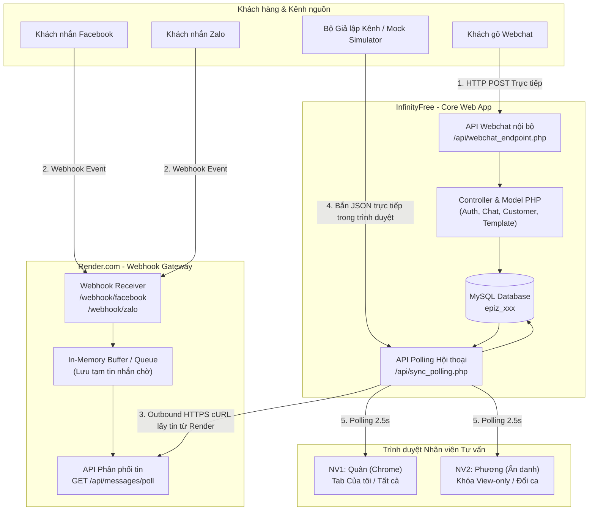

# KẾ HOẠCH XÂY DỰNG VÀ TRIỂN KHAI HỆ THỐNG QUẢN LÝ HỘI THOẠI ĐA KÊNH (OMNICHANNEL CHAT)
> **Môi trường triển khai:** InfinityFree (Web App & MySQL Database) + Render (External Webhook Gateway)  
> **Kiến trúc:** PHP MVC + JavaScript Polling + Node.js/Express Gateway  
> **Tài liệu tham chiếu:** [docs/readme.md](file:///d:/TAI%20LIEU%20HOC/N%C4%82M%204/BA/OmniChannel/docs/readme.md)

---

## I. TỔNG QUAN & ĐIỀU CHỈNH KIẾN TRÚC HẠ TẦNG

Theo đặc tả nghiệp vụ trong [docs/readme.md](file:///d:/TAI%20LIEU%20HOC/N%C4%82M%204/BA/OmniChannel/docs/readme.md), hệ thống là một ứng dụng quản lý hội thoại bán hàng đa kênh (Omnichannel CRM Chat) chạy theo mô hình MVC, tối ưu cho bài toán chia tải ca trực, chống cướp đơn (View-Only), phím tắt mẫu tin động, cảnh báo rủi ro boom hàng và gắn nhãn hội thoại.

### 1. Phân tích Hiện trạng Hạ tầng theo Yêu cầu Mới
* **Hosting chính (InfinityFree):**
  * **Điểm mạnh:** Miễn phí, hỗ trợ PHP 8.x, Apache webserver, cơ sở dữ liệu MySQL (phpMyAdmin), có sẵn domain miễn phí (dạng `*.infinityfreeapp.com` hoặc `*.epizy.com`). Rất phù hợp cho giao diện Web Chat Workspace nhân viên và khách hàng.
  * **Rào cản kỹ thuật:**
    1. *Tường lửa vBot / Epizy Security Barrier:* InfinityFree tự động kích hoạt kiểm tra JavaScript AES cookie (`__test`). Mọi HTTP POST request từ bên ngoài (như Meta/Facebook Webhook, Zalo OA Webhook, hoặc cURL/Postman không mang cookie duyệt web) sẽ nhận mã lỗi `403 Forbidden` hoặc trang HTML challenge.
    2. *Không hỗ trợ Remote MySQL:* Không thể kết nối từ máy tính ngoài hoặc từ cloud server khác trực tiếp vào cổng 3306 của InfinityFree.
    3. *Giới hạn tài nguyên:* Không cho phép chạy tiến trình ngầm (Node.js/Python server, WebSocket daemon) và giới hạn timeout kịch bản PHP (20-30s).
* **Webhook Gateway phụ trợ (Render):**
  * **Điểm mạnh:** Cung cấp Web Service miễn phí, hỗ trợ Node.js/Python/Go, cấp sẵn domain HTTPS (`*.onrender.com`), tiếp nhận 100% các request webhook từ Meta/Facebook/Zalo mà không bị rào cản bot firewall.
  * **Nhiệm vụ:** Đóng vai trò Cổng trung chuyển (Webhook Relay/Buffer) tiếp nhận sự kiện từ các kênh mạng xã hội, giải mã payload và bàn giao an toàn cho ứng dụng chính.

---

## II. MÔ HÌNH KIẾN TRÚC KẾT NỐI (HYBRID ARCHITECTURE)

Để khắc phục rào cản bảo mật của InfinityFree mà vẫn vận hành mượt mà toàn bộ các Use Case trong [docs/readme.md](file:///d:/TAI%20LIEU%20HOC/N%C4%82M%204/BA/OmniChannel/docs/readme.md), hệ thống áp dụng mô hình liên kết 2 tầng:



### Giải pháp kỹ thuật đồng bộ giữa Render và InfinityFree:
1. **Outbound HTTPS Pulling (Khuyên dùng):** InfinityFree chặn *Inbound* (kết nối từ ngoài vào), nhưng cho phép kịch bản PHP thực hiện *Outbound* cURL ra bên ngoài cổng 443. Khi file `sync_polling.php` hoặc kịch bản đồng bộ chạy, PHP trên InfinityFree gọi sang `https://your-webhook.onrender.com/api/messages/poll` để rút các tin nhắn mới về và lưu vào MySQL.
2. **Client-Side Relay (Phương án dự phòng an toàn tuyệt đối):** Trình duyệt của nhân viên (đang mở trang Workspace trên InfinityFree) có thể dùng `fetch()` trực tiếp sang Render (đã bật CORS) để lấy tin nhắn, sau đó gửi dữ liệu này vào API của InfinityFree. Vì request xuất phát từ trình duyệt thật đã có cookie `__test`, InfinityFree sẽ không bao giờ chặn!
3. **Màn hình Giả lập Kênh (Channel Simulator):** Tích hợp sẵn một thanh công cụ mô phỏng ngay trong Workspace (hoặc trang `simulator.php`) cho phép bấm gửi tin giả lập từ Facebook, Zalo, Shopee với JSON chuẩn. Đảm bảo buổi thuyết trình 100% không bị ảnh hưởng bởi lỗi mạng hay sự cố bảo mật token của bên thứ ba.

---

## III. CẤU TRÚC THƯ MỤC DỰ ÁN TỔNG THỂ

Dự án được chia thành 2 module mã nguồn:

### 1. Module Ứng dụng Chính (Triển khai lên InfinityFree `htdocs/`)
```plaintext
omnichannel-chat/
├── .htaccess                     # Định tuyến, bảo vệ thư mục nhạy cảm, chặn truy cập trực tiếp config
├── database.sql                  # Cấu trúc 6 bảng và dữ liệu mẫu (users, products, templates...)
├── config/
│   ├── database.php              # Kết nối PDO MySQL (tự thích ứng Localhost & InfinityFree)
│   └── constants.php             # Hằng số hệ thống, URL Render Webhook, API Secret Keys
├── controllers/
│   ├── AuthController.php        # Đăng nhập, đăng xuất, gạt trạng thái ca trực (Online/Offline)
│   ├── ChatController.php        # Phân phối tải (1 vs 3), khóa View-only, bàn giao đổi ca
│   ├── CustomerController.php    # Quét hồ sơ Agent, cập nhật thủ công (size, boom warning)
│   └── TemplateController.php    # Quản lý phím tắt /1, /size, thay thế biến sản phẩm tự động
├── models/
│   ├── User.php                  # Thao tác bảng users (status, chat_count)
│   ├── Conversation.php          # Quản lý hội thoại, kênh, nhãn trạng thái, phân quyền nhân viên
│   ├── Message.php               # Lưu và truy xuất tin nhắn, tệp đính kèm
│   ├── Product.php               # Tra cứu mã sản phẩm, giá bán, ảnh phục vụ template
│   ├── Template.php              # Mẫu tin nhắn nhanh có chứa placeholder
│   └── CustomerProfile.php       # Hồ sơ khách hàng, version scan, cờ cảnh báo boom
├── views/
│   ├── auth/
│   │   └── login.php             # Màn hình đăng nhập nhân viên
│   └── chat/
│       ├── workspace.php         # Không gian làm việc tập trung (Header + 3 phân vùng)
│       └── simulator.php         # Bảng điều khiển giả lập bắn tin Facebook/Zalo/Shopee
├── api/
│   ├── webchat_endpoint.php      # Tiếp nhận tin nhắn từ widget webchat của khách
│   ├── sync_polling.php          # Endpoint AJAX Polling (2.5s) cho nhân viên + kéo tin Render
│   ├── template_api.php          # API trả về nội dung template khi gõ phím tắt
│   └── customer_api.php          # API quét lại hồ sơ Agent và cập nhật thẻ khách
└── public/
    ├── css/
    │   ├── style.css             # Giao diện Workspace chuẩn thiết kế hiện đại, bảng màu trực quan
    │   └── widget.css            # Style cho cửa sổ chat nổi của khách hàng
    ├── js/
    │   ├── workspace.js          # Core logic: Polling, filter tabs, shortcut /1, inline edit, locking
    │   └── simulator.js          # Logic gửi payload mô phỏng kênh
    ├── widget/
    │   └── webchat.js            # Đoạn mã JavaScript nhúng vào trang bán hàng
    └── uploads/                  # Thư mục lưu ảnh đính kèm tin nhắn (cần phân quyền ghi 777/755)
```

### 2. Module Webhook Gateway (Triển khai lên Render.com)
```plaintext
omnichannel-webhook-gateway/
├── package.json                  # Cấu hình dự án Node.js (Express, cors, dotenv)
├── server.js                     # Web server tiếp nhận webhook Meta/Zalo
├── routes/
│   ├── meta.js                   # Xử lý xác thực GET hub.challenge & nhận POST Facebook
│   ├── zalo.js                   # Tiếp nhận Webhook từ Zalo Official Account
│   └── poll.js                   # Endpoint cho InfinityFree/Trình duyệt lấy tin chờ
└── .env.example                  # File mẫu biến môi trường (PORT, VERIFY_TOKEN, API_KEY)
```

---

## IV. ĐẶC TẢ CHI TIẾT CÁC USE CASE & THUẬT TOÁN ĐIỀU PHỐI

Bảo toàn đầy đủ tất cả các tính năng nghiệp vụ theo [docs/readme.md](file:///d:/TAI%20LIEU%20HOC/N%C4%82M%204/BA/OmniChannel/docs/readme.md):

| Nhóm Use Case | Tên Chức Năng | Logic Kỹ Thuật Chi Tiết |
| :--- | :--- | :--- |
| **UC1.1, UC1.2** | Tiếp nhận & Phân loại Đa kênh | Hỗ trợ 4 kênh: `WEBCHAT`, `FACEBOOK`, `ZALO`, `SHOPEE`. Có bộ lọc chip `[🔘 Chưa trả lời]` đưa các tin `status = 'UNREPLIED'` lên đầu để chống trôi tin quá 15 phút. |
| **UC2.1** | Thuật toán Chia tải Ca trực | Khi tin nhắn mới đến từ khách chưa có người phụ trách: Hệ thống truy vấn các nhân viên có `status = 'ONLINE'`, chọn người có `current_chat_count` thấp nhất để gán `assigned_user_id`. (Mô phỏng chính xác kịch bản 1 vs 3). |
| **UC2.2** | Bộ lọc & Khóa Quyền Phản hồi (View-Only) | Tab `[ Của tôi ]` chỉ hiện hội thoại của user hiện tại. Tab `[ Tất cả ]` hiện toàn bộ. Nếu user click vào hội thoại của đồng nghiệp phụ trách: Khung chat hiện Banner cảnh báo màu xám `🔒 Chế độ Chỉ xem (View-only)` và vô hiệu hóa hoàn toàn ô gõ phím. |
| **UC2.3** | Bàn giao Hội thoại Đổi ca | Khi NV1 gạt nút ca trực sang `OFFLINE`. Khách hàng gửi thêm tin mới. Hệ thống tự động chuyển giao hội thoại sang NV2 (`ONLINE`), gỡ bỏ View-Only trên màn hình NV2 và cập nhật avatar người trực. |
| **UC3.1, UC3.2** | Phím tắt Template & Đính kèm | Gõ `/1` -> Hệ thống bắt sự kiện `keyup`, gọi API lấy dữ liệu sản phẩm mẫu (ví dụ: SP01 - Váy Dạ Tweed - 350.000đ) thay thế vào ô nhập. Hỗ trợ modal popup tạo nhanh template với các biến placeholder `[ten_sp]`, `[gia]`. Nút ghim đính kèm tệp ảnh tải lên `uploads/`. |
| **UC3.3** | Agent Bóc tách & Cảnh báo Rủi ro | Nút `[ Quét lại dữ liệu (Agent) ⟳ ]` kích hoạt animation quét dữ liệu. Hệ thống phân tích lịch sử hội thoại, bóc tách `Size M`, nhận diện từ khóa boom hàng trong quá khứ để bật huy hiệu đỏ `[⚠ TỪNG BOOM 1 ĐƠN - ĐỀ NGHỊ CỌC TRƯỚC]`. Cho phép bấm biểu tượng bút chì `[✎]` để sửa trực tiếp. |
| **UC3.4** | Gắn nhãn Hội thoại (Tagging) | 4 nhãn màu chuẩn: Xanh lá (Đang tư vấn), Xanh dương (Đã chốt đơn), Vàng (Chờ chuyển khoản), Đỏ (Khách boom). Đổi nhãn sẽ cập nhật trực tiếp màu badge ở Sidebar trái. |

---

## V. KẾ HOẠCH TRIỂN KHAI THEO TỪNG GIAI ĐOẠN (6 PHASES)

### Giai đoạn 1: Thiết lập CSDL & Cấu trúc Nền tảng (Database & Setup)
* **Thời gian dự kiến:** 0.5 ngày
* **Nhiệm vụ chi tiết:**
  1. Tạo CSDL `database.sql` chuẩn MySQL InnoDB với bảng mã `utf8mb4_unicode_ci` theo schema trong [docs/readme.md](file:///d:/TAI%20LIEU%20HOC/N%C4%82M%204/BA/OmniChannel/docs/readme.md).
  2. Nạp dữ liệu mock khởi tạo:
     * 2 tài khoản nhân viên: `nv1 / 123456` (Nguyễn Văn Quân), `nv2 / 123456` (Trần Thị Phương) với mật khẩu hash hoặc chuẩn demo.
     * Sản phẩm mẫu: `SP01` (Váy Dạ Tweed, 350.000đ), `SP02` (Áo Blazer Hàn Quốc, 420.000đ).
     * Template mẫu: `/1`, `/size`, `/stk`.
     * 3-5 hội thoại mẫu đa kênh (Facebook, Zalo, Webchat) để sẵn sàng kiểm thử.
  3. Xây dựng lớp cấu hình [config/database.php](file:///d:/TAI%20LIEU%20HOC/N%C4%82M%204/BA/OmniChannel/config/database.php) tự động nhận diện môi trường:
     * Nếu chạy Localhost (XAMPP): dùng `localhost`, user `root`, pass `""`.
     * Nếu chạy InfinityFree: đọc cấu hình `sqlxxx.infinityfree.com`, `epiz_xxxx`, database `epiz_xxxx_omnichannel`.
  4. Tạo file `.htaccess` để bảo vệ thư mục `config`, `models` và thiết lập CORS cho phép Webchat widget kết nối.

### Giai đoạn 2: Lập trình Backend Core & Nghiệp vụ MVC (PHP)
* **Thời gian dự kiến:** 1 ngày
* **Nhiệm vụ chi tiết:**
  1. **Models:** Xây dựng các hàm PDO chuẩn cho `User`, `Conversation`, `Message`, `CustomerProfile`, `Template`, `Product`.
  2. **AuthController:** 
     * Xử lý đăng nhập, ghi nhận Session `user_id`.
     * Xử lý API chuyển đổi trạng thái ca trực `status = 'ONLINE'` hoặc `'OFFLINE'`.
  3. **ChatController:**
     * Hàm lấy danh sách hội thoại theo bộ lọc (Tất cả / Của tôi / Chưa trả lời).
     * Logic khóa View-Only: kiểm tra `assigned_user_id == current_user_id`.
     * Thuật toán phân bổ tự động (Load Balancing): tìm nhân viên `ONLINE` có ít cuộc trò chuyện nhất.
     * Logic đổi ca tự động (Shift Transfer): khi nhân viên phụ trách `OFFLINE` mà có tin mới đến.
  4. **CustomerController & TemplateController:**
     * API quét Agent (giả lập trích xuất thực thể NER và tăng version scan v1.0 -> v2.0).
     * API cập nhật thông tin hồ sơ (inline edit) và đổi Tag trạng thái.
     * API tra cứu và lưu trữ template.
  5. **API Endpoints:**
     * `api/webchat_endpoint.php`: Tiếp nhận tin nhắn gửi từ khách truy cập web.
     * `api/sync_polling.php`: Trả về tin nhắn mới, danh sách hội thoại cập nhật và trạng thái ca trực theo chu kỳ polling.

### Giai đoạn 3: Lập trình Giao diện Không gian Chat (Frontend Workspace & Widget)
* **Thời gian dự kiến:** 1 ngày
* **Nhiệm vụ chi tiết:**
  1. **Màn hình Đăng nhập ([views/auth/login.php](file:///d:/TAI%20LIEU%20HOC/N%C4%82M%204/BA/OmniChannel/views/auth/login.php)):** Thiết kế tinh tế, hỗ trợ nút bấm điền nhanh tài khoản Quân (NV1) hoặc Phương (NV2) để tiết kiệm thời gian khi demo.
  2. **Màn hình Chat Workspace 3 Phân vùng ([views/chat/workspace.php](file:///d:/TAI%20LIEU%20HOC/N%C4%82M%204/BA/OmniChannel/views/chat/workspace.php)):**
     * *Header:* Hiển thị thông tin ca trực, nút gạt dropdown Online/Offline, nút Đăng xuất.
     * *Sidebar Trái:* Ô tìm kiếm JS, 2 tab lọc (Tất cả / Của tôi), nút chip `Chưa trả lời`, danh sách thẻ chat có logo kênh, avatar người phụ trách, thời gian tương đối.
     * *Khung Chat Trung tâm:* Khung hội thoại tin nhắn, thanh thông báo xám khóa View-Only khi xem chéo, ô nhập tin nhắn, icon đính kèm ảnh, popup thêm template.
     * *Sidebar Phải:* Thẻ thông tin khách, huy hiệu đỏ cảnh báo boom hàng, nút bấm quét Agent có animation chạy chữ, các nút chọn Tag trạng thái 4 màu.
  3. **Tương tác JavaScript ([public/js/workspace.js](file:///d:/TAI%20LIEU%20HOC/N%C4%82M%204/BA/OmniChannel/public/js/workspace.js)):**
     * Cơ chế AJAX Polling lặp lại mỗi 2.5 giây gọi `sync_polling.php`.
     * Bắt sự kiện gõ phím `/1` tự bung nội dung sản phẩm.
     * Xử lý mở/khóa ô chat mượt mà không cần reload trang.
  4. **Widget Webchat ([public/widget/webchat.js](file:///d:/TAI%20LIEU%20HOC/N%C4%82M%204/BA/OmniChannel/public/widget/webchat.js)):**
     * Bong bóng chat nhỏ gọn góc phải dưới màn hình.
     * Khách hàng nhập tên, bấm gửi tin nhắn trực tiếp vào hệ thống.

### Giai đoạn 4: Xây dựng Module Webhook Gateway trên Render
* **Thời gian dự kiến:** 0.5 ngày
* **Nhiệm vụ chi tiết:**
  1. Khởi tạo ứng dụng Node.js/Express siêu nhẹ (`server.js`).
  2. Xây dựng endpoint xác minh Webhook của Meta Facebook:
     ```javascript
     app.get('/webhook/facebook', (req, res) => {
         const mode = req.query['hub.mode'];
         const token = req.query['hub.verify_token'];
         const challenge = req.query['hub.challenge'];
         if (mode === 'subscribe' && token === process.env.VERIFY_TOKEN) {
             return res.status(200).send(challenge);
         }
         return res.sendStatus(403);
     });
     ```
  3. Xây dựng endpoint tiếp nhận sự kiện POST từ Facebook/Zalo:
     * Trích xuất thông tin người gửi, nội dung tin nhắn, kênh nguồn.
     * Đẩy vào hàng đợi tạm thời (Queue) trong bộ nhớ.
  4. Xây dựng endpoint `GET /api/messages/poll`:
     * Cho phép máy chủ InfinityFree hoặc trình duyệt nhân viên gọi sang để rút toàn bộ tin nhắn đang chờ trong hàng đợi.
  5. Cấu hình CORS để cho phép frontend gọi lấy tin mà không bị chặn trình duyệt.

### Giai đoạn 5: Hướng dẫn Triển khai Thực tế (InfinityFree + Render)
* **Thời gian dự kiến:** 0.5 ngày

#### Bước A: Đưa Website lên InfinityFree
1. Đăng ký tài khoản tại [infinityfree.com](https://www.infinityfree.com), tạo một tài khoản Hosting mới (chọn subdomain miễn phí dạng `omnichannel-demo.infinityfreeapp.com`).
2. Vào trang quản trị cPanel của InfinityFree:
   * Mở mục **MySQL Databases**: Tạo mới cơ sở dữ liệu `epiz_xxxx_omnichannel`. Ghi lại MySQL Hostname (dạng `sqlxxx.infinityfree.com`), Username (`epiz_xxxx`), Password.
   * Mở **phpMyAdmin**: Chọn database vừa tạo, bấm tab **Import** và tải lên file `database.sql`.
3. Tải mã nguồn lên Hosting:
   * Dùng tính năng **Online File Manager** hoặc phần mềm **FileZilla** kết nối qua FTP (Host, User, Port 21).
   * Tải toàn bộ nội dung trong thư mục dự án vào thư mục `htdocs/`.
4. Cập nhật thông tin kết nối CSDL trong file `config/database.php` với các thông số vừa ghi lại ở bước 2.
5. Kiểm tra truy cập domain: Đăng nhập thử bằng tài khoản `nv1` để kiểm tra kết nối CSDL thành công.

#### Bước B: Đưa Webhook Gateway lên Render
1. Đưa mã nguồn thư mục `omnichannel-webhook-gateway/` lên một repository GitHub cá nhân.
2. Đăng nhập [render.com](https://render.com), chọn **New +** -> **Web Service**.
3. Kết nối với repo GitHub vừa tạo, chọn Runtime là **Node**, lệnh Build là `npm install`, lệnh Start là `node server.js`.
4. Trong mục **Environment Variables**, cấu hình:
   * `VERIFY_TOKEN`: Mã bí mật tùy chọn (dùng để điền vào trang cấu hình Facebook App).
   * `API_SECRET_KEY`: Khóa bảo mật để kiểm tra quyền truy cập API lấy tin.
5. Bấm **Deploy Web Service**. Sau 1-2 phút, Render sẽ cấp URL công khai dạng: `https://omnichannel-gateway.onrender.com`.
6. Điền URL Render này vào file `config/constants.php` trên InfinityFree.

---

## VI. KỊCH BẢN KIỂM THỬ THỰC CHIẾN (DEMO WALKTHROUGH CHECKLIST)

Bảo đảm tuần tự 6 bước diễn tập theo đúng kịch bản đạt điểm tối đa trong [docs/readme.md](file:///d:/TAI%20LIEU%20HOC/N%C4%82M%204/BA/OmniChannel/docs/readme.md):

```
+-------------------------------------------------------------------------------------------------+
|                                 BẢNG KIỂM TRA KỊCH BẢN DEMO                                     |
+------+-----------------------+----------------------------------+-------------------------------+
| BƯỚC | THAO TÁC THỰC HIỆN    | HIỆN TƯỢNG TRÊN HỆ THỐNG         | KẾT QUẢ ĐẠT ĐƯỢC              |
+------+-----------------------+----------------------------------+-------------------------------+
| 1    | Mở 2 trình duyệt:     | Cả 2 tài khoản hiển thị          | Xác thực phân quyền ca trực,  |
|      | - Chrome: Đăng nhập   | trạng thái "● Đang trực tuyến",  | khởi tạo phiên làm việc độc   |
|      |   nv1 (Quân)          | danh sách tải đồng bộ qua AJAX.  | lập cho 2 tư vấn viên.        |
|      | - Ẩn danh: Đăng nhập  |                                  |                               |
|      |   nv2 (Phương)        |                                  |                               |
+------+-----------------------+----------------------------------+-------------------------------+
| 2    | Mở trang khách hàng,  | Tin nhắn xuất hiện ngay ở đầu    | UC1.1, UC1.2, UC2.1:          |
|      | mở Webchat gõ:        | danh sách có icon Webchat.       | Chia tải tự động 1 vs 3.      |
|      | "Shop ơi mẫu áo dạ    | Hệ thống tự gán cho Quân (NV1)   | Hội thoại tự động nhảy vào    |
|      | mã SP01 còn size ko?" | vì Quân đang ít khách hơn.       | tab "Của tôi" của Quân.       |
+------+-----------------------+----------------------------------+-------------------------------+
| 3    | Tại màn hình Phương   | Khung chat của Phương hiện dải   | UC2.2 (extend):               |
|      | (NV2): Bấm tab Tất cả | banner xám: "🔒 Chế độ Chỉ xem   | Chống cướp đơn hàng giữa      |
|      | và click vào khách    | - Đang tư vấn bởi Quân".         | các nhân viên trong ca trực.  |
|      | của Quân vừa nhắn.    | Toàn bộ ô nhập liệu bị khóa cứng.|                               |
+------+-----------------------+----------------------------------+-------------------------------+
| 4    | Tại màn hình Quân:    | Hệ thống tự bung mẫu: "Chào bạn, | UC3.1, UC3.2:                 |
|      | Ô chat mở bình thường.| mẫu Váy Dạ Tweed (Mã: SP01) giá  | Template biến động từ CSDL,   |
|      | Gõ phím tắt /1 và     | 350.000đ...". Bấm gửi kèm ảnh    | gửi đính kèm đa phương tiện.  |
|      | ghim ảnh bảng size.   | hiển thị bong bóng chat mượt mà. |                               |
+------+-----------------------+----------------------------------+-------------------------------+
| 5    | Tại Sidebar Phải của  | Hiệu ứng quét chữ kích hoạt,     | UC3.3, UC3.4:                 |
|      | Quân: Bấm nút         | nhảy version v1.0 -> v2.0.       | Agent bóc tách thông tin,     |
|      | [ Quét dữ liệu Agent ]| Bật huy hiệu đỏ: "⚠ TỪNG BOOM    | phát hiện cờ đỏ rủi ro cao,   |
|      | -> Đổi Tag trạng thái.| 1 ĐƠN". Đổi tag "Chờ CK" -> thẻ  | cập nhật thẻ khách tức thì.   |
|      |                       | bên trái đổi sang màu vàng.      |                               |
+------+-----------------------+----------------------------------+-------------------------------+
| 6    | - Quân gạt sang:      | - Webchat nhận tin mới.          | UC2.3:                        |
|      |   "○ Rời ca trực"     | - Màn hình Phương (NV2) lập tức  | Chuyển giao đổi ca tự động,   |
|      | - Khách nhắn thêm tin |   mất banner View-Only, chuyển   | không làm gián đoạn trải      |
|      |   từ Webchat.         |   avatar sang Phương, mở ô gõ.   | nghiệm tư vấn của khách hàng. |
+------+-----------------------+----------------------------------+-------------------------------+
```

---

## VII. PHÂN CÔNG NHIỆM VỤ & LỊCH TRÌNH THỰC HIỆN

| Thành viên | Nhiệm vụ Trọng tâm | Sản phẩm Bàn giao |
| :--- | :--- | :--- |
| **Bạn & Quân (NV1)** | - Thiết lập CSDL & cấu hình kết nối InfinityFree.<br>- Lập trình Backend Controller (Auth, Chat) & Thuật toán chia tải.<br>- Viết API Webchat & Polling đồng bộ tin nhắn. | - `config/database.php`, `database.sql`<br>- `controllers/AuthController.php`, `ChatController.php`<br>- `api/sync_polling.php`, `api/webchat_endpoint.php` |
| **Nhung & Bạn (NV2)** | - Xây dựng giao diện Khung chat trung tâm & Sidebar trái.<br>- Xử lý JavaScript cho cơ chế Khóa View-only, chuyển tab Tất cả / Của tôi.<br>- Xây dựng Webhook Gateway trên Render kết nối về hệ thống. | - `views/chat/workspace.php`, `views/auth/login.php`<br>- `public/js/workspace.js`<br>- Mã nguồn `omnichannel-webhook-gateway` trên Render |
| **Phương & Ngân (NV3)** | - Lập trình Sidebar Phải: Thẻ hồ sơ Agent, cảnh báo rủi ro boom hàng, gắn nhãn màu 4 trạng thái.<br>- Lập trình tính năng phím tắt `/1` lấy sản phẩm động và modal thêm template.<br>- Chuẩn bị dữ liệu demo & kịch bản diễn tập thuyết trình. | - `controllers/CustomerController.php`, `TemplateController.php`<br>- `public/css/style.css`<br>- Dữ liệu mock sản phẩm, khách hàng, ảnh bảng size |

---

## VIII. PHƯƠNG ÁN DỰ PHÒNG & XỬ LÝ SỰ CỐ TẠI BUỔI THUYẾT TRÌNH

1. **Sự cố Render bị Sleep do gói Free (Cold Start 30-50s):**
   * *Biện pháp:* Trước giờ thuyết trình 5 phút, mở trình duyệt truy cập thẳng vào URL `https://your-webhook.onrender.com` để đánh thức dịch vụ sẵn sàng hoạt động.
2. **Sự cố Mạng trường chặn kết nối hoặc InfinityFree phản hồi chậm:**
   * *Biện pháp:* Mở sẵn một bản sao lưu chạy trên **Localhost XAMPP** trong máy. Vì kiến trúc mã nguồn được thiết kế dùng chung cấu trúc MVC, nhóm có thể chuyển đổi trong 30 giây bằng cách mở tab `localhost/omnichannel-chat` nếu mạng Internet gặp sự cố.
3. **Sự cố Webhook từ Facebook Meta bị hạn chế quyền:**
   * *Biện pháp:* Bật sẵn trang [views/chat/simulator.php](file:///d:/TAI%20LIEU%20HOC/N%C4%82M%204/BA/OmniChannel/views/chat/simulator.php) trên một tab riêng. Chỉ cần bấm nút *"Giả lập khách Facebook gửi tin"* là dữ liệu chuẩn định dạng JSON sẽ bắn vào hệ thống, chứng minh hoàn hảo kiến trúc xử lý đa kênh mà không cần dựa vào tài khoản cá nhân thật.
